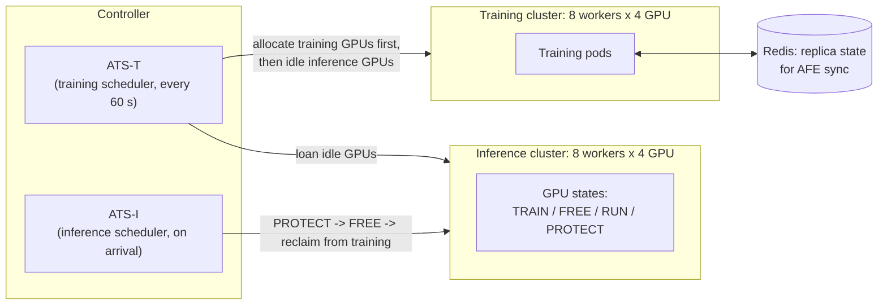

# DeepBoot: Original Paper vs Our Experimental Reproduction

**Document status:** research audit, 2026-11-27. Written from the repository at `main` / `82b0a41`. No simulator code, experiment script or result was modified, and no new experiment was run for this audit.

**How to read the evidence labels used throughout**

| Label | Meaning |
|---|---|
| **[Paper]** | Stated in the original paper (page = journal page number printed on the PDF, e.g. p. 2561). |
| **[Paper-fig≈]** | Value read by eye from a paper figure. Approximate; reading error is roughly ±0.02 h on Fig. 9/13/14 bars and ±1 h on Fig. 11(b). The PDF contains no data tables for these figures. |
| **[Code]** | Verified by reading the repository source (file:line). |
| **[Raw]** | Recomputed by this audit from raw simulator outputs (`summary.json`, `gpu.log`, `job-metrics.csv`, `analysis-summary.json`). |
| **[Team report]** | Taken from a team report and not independently recomputed. |
| **[Inference]** | This audit's own interpretation or hypothesis. Not established by the paper or by our experiments. |

---

## 1. Executive Summary

### Project objective
We study DeepBoot (Chen, Zhao, Zhi, Yin, *IEEE TPDS* 34(9), 2023, DOI 10.1109/TPDS.2023.3293835), a scheduler that lends idle GPUs in an inference cluster to elastic training jobs. We use the authors' discrete-time simulator to reproduce parts of the paper's evaluation, ablate its mechanisms, and identify an extension.

### What we reproduced
- **DeepBoot on the small workload** with the paper's default configuration (ATS-T + AFE + ATS-I). The verified run (E08 rerun) gives a training mean JCT of **2,348 s (0.652 h)**. The paper's Fig. 9 bar reads **≈0.66 h** and its Fig. 13 "1×" point reads **≈0.65 h**. Simulated makespan was **18.1 h**, against **≈18 h** read from Fig. 11(b). This is the closest numerical agreement in the project.
- **Partial reproductions** with configuration differences: AFS small (E03/E06), Pollux small (E05), DeepBoot middle with AFE off (E04), and DeepBoot with RANDOM inference allocation (E07 and the controlled three-seed study).

### What we investigated
1. E01/E02 configuration forensics. E02's invocation could not be recovered, and a verified rerun was produced.
2. An AISS on/off ablation.
3. A controlled ATS-I vs RANDOM inference-allocation comparison (3 matched hash seeds).
4. Pollux optimization-time overhead.

### Overall reproduction assessment
**Partial, with strong agreement on DeepBoot's own small-workload headline numbers and on several qualitative trends.** Several paper figures were never attempted: the 38% baseline reduction, Optimus/Tiresias/Aryl, the large workload, large-scale training (Fig. 15) and the testbed (Table II). The paper's headline claim ("38% average JCT reduction vs. a baseline that does not use inference GPUs") **cannot be evaluated yet**, because the pure-training baseline was never run.

### Main findings
- DeepBoot small (AFE on) matches Fig. 9 and Fig. 11(b) within graph-reading error **[Raw vs Paper-fig≈]**.
- The workload-scaling trend from small to middle (+17.0% training mean JCT, AFE off) has the same direction and similar size as the paper's DeepBoot bars (≈+17%, AFE on) **[Raw vs Paper-fig≈]**.
- ATS-I beats the repository's RANDOM path on training mean JCT by 5.1% (3/3 matched seeds). The paper's Fig. 14 shows ≈8% at the small scale. The direction agrees **[Raw]**.
- AFE reduces modelled rescale delay by 59% but training mean JCT by only ≈4%. Nearly all of the mean gain comes from the 4 ImageNet jobs. The paper's large percentile speed-ups (≈1.7× at the 95th percentile, Fig. 12a) are **not** reproduced **[Raw]**.
- AISS (warm-pod protection) cuts inference mean JCT by 27%, with no clear training effect on the small workload **[Raw]**. The paper does not report inference latency at all.
- Pollux's NSGA-II costs ≈0.7–1.0 s per decision against ≈0.14 s for DeepBoot's knapsack. This agrees qualitatively with Fig. 11(a). However, **the simulator never charges this time to simulated time** **[Code]**, so the makespan penalty the paper reports for Pollux (Fig. 11b) cannot appear in our simulated results.

### Remaining gaps
- No pure-train baseline. No Optimus/Tiresias/Aryl runs. No large workload. No repeated AFE-on runs.
- E02 and its verified rerun E08 disagree (2,374.6 s vs 2,348.0 s) although the simulator source is identical. This determinism question is unresolved.
- Several paper/implementation discrepancies remain. The most important: inference counts are 2× the paper's stated ratio; restart costs differ from Table I; RANDOM is not random; scheduling latency is not modelled (Section 7.3).

---

## 2. Background and Research Motivation

### 2.1 Original problem **[Paper, pp. 2553–2556]**
- Organisations run **separate clusters**: training on large-memory GPUs (V100/A100) and inference on cheaper GPUs (T4).
- Both clusters show **diurnal load**. The paper cites inference-cluster utilisation below 40% at ByteDance [23]. Meanwhile, training jobs queue for GPUs.
- **Central question:** can training jobs safely borrow idle inference GPUs, and give them back immediately when inference requests arrive, without paying large restart costs or harming inference responsiveness?

### 2.2 Why it is hard **[Paper, p. 2554]**
1. **Allocation is NP-hard.** Pollux uses the NSGA-II genetic algorithm. Its cost (O(k·p·n²·m²), p. 2556) grows sharply when inference jobs are added, and it is too slow for decisions that must be immediate.
2. **When and which inference GPUs to lend or reclaim.** Aggressive lending causes restart storms. Conservative lending wastes idle GPUs.
3. **Restart overhead.** The default "Stop-Resume" restart takes 20–100+ s (Fig. 1, Table I). Frequent reclaiming by inference makes this dominant: Fig. 2 shows "real" GPU utilisation far below allocated utilisation.

### 2.3 DeepBoot's approach and contributions **[Paper, p. 2554]**
1. **ATS (Adaptive Task Scaling).** ATS-T allocates training jobs with a group-knapsack algorithm that maximises the sum of SPEEDUP. ATS-I places inference requests and reclaims GPUs at GPU granularity, with a protection lifecycle.
2. **AFE (Auto-Fast Elastic) training.** Elastic training compatible with Pollux's checkpoint scheme, so surviving replicas avoid a full restart.
3. **A Kubernetes implementation** evaluated on a testbed and in a simulator, using the Microsoft (Philly) workload.

---

## 3. Original DeepBoot Architecture

### 3.1 System overview **[Paper, Fig. 5, pp. 2557–2558]**



### 3.2 ATS-T: training scheduling **[Paper, Sec. IV-A, Alg. 1–2, pp. 2558–2559]**
- **Objective:** FITNESS(A) = Σⱼ SPEEDUPⱼ(Aⱼ) (Eq. 1). SPEEDUP = GOODPUT(θ)/GOODPUT(θ₀). GOODPUT = THROUGHPUT × statistical EFFICIENCY, taken from Pollux.
- **Group knapsack:** each job is a group of items with weight w ∈ {1..max_replicas} and value SPEEDUP(w). The capacity is the number of free GPUs. The complexity is O(n·m²), against NSGA-II's O(k·p·n²·m²).
- **Restart penalty:** f = (age − restarts·delay)/(age + delay) discourages frequent reallocation.
- **Replica2Allocation:** keeps unchanged allocations, packs a job onto as few workers as possible, and prefers workers with the fewest sufficient free GPUs.
- Runs every **60 s**.

### 3.3 ATS-I: inference scheduling and GPU lifecycle **[Paper, Sec. IV-B, Alg. 3, Fig. 7, pp. 2559–2560]**
- **GPU states:** TRAIN → FREE → RUN → PROTECT → FREE.
- **Placement order for each request:**
  1. a PROTECT GPU, choosing the one with the largest `g.cnt`;
  2. otherwise a FREE GPU on the worker with the fewest FREE GPUs;
  3. otherwise reclaim the training GPU whose removal gives the largest ΔSPEEDUP (the least harm).
- **Protection time:** t_p = min(t_p,max, t_p,min + g.cnt·interval). The settings are **t_p,min = 30 s, interval = 15 s, t_p,max = 120 s** (p. 2562).
- Reclaiming at GPU granularity is contrasted with Aryl's worker-level reclaiming.

### 3.4 AFE **[Paper, Sec. V, pp. 2560–2561]**
- On scale-up or scale-down, unchanged pods keep running. Rank 0 saves state, all pods synchronise through Redis flags, then all reload.
- New pods still pay container start-up. Surviving replicas pay only "save/load state".
- Rank 0 is kept on the worker with the most replicas, so it is less likely to be reclaimed.
- Table I gives restart time without/with AFE per model, e.g. ImageNet 149.5 s / 2.6 s and BERT 117.8 s / 5.3 s.

### 3.5 Terminology mapping: paper vs repository flags **[Code, `experiment/cmd/README.md`]**

| Paper term | Repository flag / code | What the code actually controls |
|---|---|---|
| ATS-T | `--policy dp` → `DeepBoot` class (`dp.py`) | Group knapsack `max_value_dp` (`dp.py:88`), `allocate_elastic` (`dp.py:111`) |
| ATS-I GPU selection | `InferScheduler.ATSI_infer_schedule` (`infer_scheduler.py:455`), used when `--random_allocate 0` and `--ARYL 0` | Free/sleep GPU placement and reclaim with best ΔSPEEDUP (`infer_scheduler.py:113,200`) |
| ATS-I lifecycle (PROTECT) | `--AISS` (README: "Equal to ATS-I") | **Only** the pod PROTECT/warm-reuse lifecycle (`simulator.py:214,333,533–549`). It does **not** switch the GPU-selection algorithm. |
| AFE | `--AFE` | Rescale delay = `FIRST_DELAY`/`NEXT_DELAY` formula instead of the full `APPLICATIONS_DELAY` (`simulator.py:339–358,389–395`) |
| Aryl reclaiming | `--ARYL 1` | Worker-level reclaiming (`aryl_remove`, `simulator.py:502,666`; `infer_scheduler.py:74,168`) |
| Random preemption | `--random_allocate 1` | `random_allocate()` (`infer_scheduler.py:359`). **Not RNG-based** (Section 9.3). |
| Protection scale (Fig. 13) | `--protect_times` | Multiplies 30/15/120 (`simulator.py:72–76`) |
| Pollux NSGA-II for inference | `--policy pollux --INFER_SCHEDULER 0` | NSGA-II runs on every event, including inference jobs |

> **Important:** "AISS" does not appear in the paper. It is a repository flag. Calling AISS=0 "ATS-I disabled" would be wrong. AISS=0 removes the PROTECT/warm-reuse lifecycle, but GPU placement still uses ATS-I.

---

## 4. Original Paper's Experimental Methodology **[Paper, Sec. VII-A, pp. 2561–2562]**

### 4.1 Simulator setup

| Item | Paper value |
|---|---|
| Simulator | Discrete-time, based on Pollux's simulator |
| Cluster | 16 workers × 4 GPUs = 64 GPUs. 8 training workers + 8 inference workers |
| Training scheduling interval | 60 s |
| Inference check | every 1 s. One replica per inference task |
| Training workload | 160 Pollux jobs drawn from the Microsoft trace (Table I mix) |
| Inference workload | GPU-reclaiming events over 16 h. Small (10×, 10), Middle (50×, 20), Large (100×, 30). For Small: inference count = 10× training count; durations uniformly 1–10 s |
| Protection | t_p,min 30 s, interval 15 s, t_p,max 120 s |
| Baseline | Pollux on 8 training workers only (32 GPUs); ATS-I for inference on the other half |
| Default config | ATS-T + AFE + ATS-I unless stated otherwise |
| Baselines (training) | Optimus, Tiresias, AFS, Pollux, Aryl |
| Baselines (inference) | Random preemption, Aryl, ATS-I |
| Metrics | Average training JCT, queue time, makespan, GPU usage (pod-allocated share) and "real" GPU usage (share computing gradients) |
| Repetitions / variance | **Not reported** |

### 4.2 Testbed **[Paper, p. 2561]**
8 workers (4 training, 4 inference) × 2 P40 GPUs, Kubernetes 1.18.2, NFS at 10 GB/s. ImageNet removed. Jobs reduced to 1/4 and epochs to 1/2. **Not reproducible by us** (no hardware).

### 4.3 Paper figures/tables relevant to our project

| Fig./Table | Page | Purpose | Main result (approximate values marked ≈) | Authors' interpretation |
|---|---|---|---|---|
| Table I | 2554 | Restart cost w/o / w/ AFE, job mix | ResNet18 38.9/2.8 s (41.3%), YOLOv3 40.8/3.1 (1.8%), ResNet50-ImageNet 149.5/2.6 (2.5%), BERT 117.8/5.3 (4.4%), DeepSpeech2 32.6/1.4 (7.5%), NeuMF 29.8/– (42.0%) | AFE cuts restarts to a few seconds |
| Fig. 9 | 2562 | Avg training JCT by scheduler × scale (sim.) | Baseline (pure train) ≈1.23 h. S/M/L: Optimus ≈1.30/1.57/1.97; Tiresias ≈0.75/1.13/2.18; AFS ≈0.93/1.31/1.84; Pollux ≈0.55/0.70/1.17; **DeepBoot ≈0.66/0.77/1.04 h** | DeepBoot −38% vs baseline at middle; 2.0×/1.5×/1.3× vs Optimus/Tiresias/AFS (middle); Pollux slightly better at S/M, DeepBoot better at L |
| Fig. 10 | 2563 | GPU utilisation time series | DeepBoot/Pollux "stable and high"; baseline ≈45–50% | Over-allocation (AFS) causes reclaiming |
| Fig. 11(a) | 2563 | CDF of Pollux decision cost | Large: ≈20% of decisions > 4 s; some > 10 s at all scales | NSGA-II too slow for real-time inference |
| Fig. 11(b) | 2563 | Makespan | Small ≈: DeepBoot 18, AFS 21, Optimus 22, Tiresias 23, Pollux 26 h. Pollux rises to ≈44 h (M) and ≈74 h (L) | Pollux overhead is unacceptable |
| Fig. 12(a–c) | 2564 | AFE benefit | Speed-up ratio w/ AFE (S/M/L) ≈ avg 1.0/1.03/1.14; p50 1.17/1.16/1.30; p95 1.73/1.63/1.80. Pending-time share falls; GPU util. rises | AFE matters most for large jobs (ImageNet, BERT) |
| Fig. 13 | 2564 | Protection-time scale 0/1×/2×/4× | Small ≈0.67/0.65/0.67/0.66 h; Middle ≈0.78/0.72/0.78/0.80; Large ≈1.05/0.81/1.05/1.49 | 1× protection is best; 0 causes preemption, 4× wastes GPUs |
| Fig. 14 | 2564 | Inference reclaim: Random / Aryl / ATS-I (legend says "AFE-I") | Small ≈0.72/0.71/0.67; Middle ≈0.83/0.88/0.77; Large ≈1.27/1.10/1.05 h | Random degrades as load grows; ATS-I best |
| Fig. 15 | 2564 | 1,600 jobs on 160 workers, pure training | DeepBoot avg JCT 1.25× faster than Pollux | NSGA-II fails at scale |
| Table II | 2564 | Testbed | Baseline 7,245 s; DeepBoot 4,934 s (−32%); Pollux 5,005 s | Same conclusions as simulator |

**Internal inconsistencies in the paper (noted, not resolved):**
1. Middle-scale DeepBoot is ≈0.77 h in Figs. 9 and 14 but ≈0.72 h at the "1×" point of Fig. 13.
2. The text's DeepBoot-vs-AFS ratios (1.1×, 1.3×, 1.4×) do not match the AFS bars as we read them (≈1.4×, ≈1.7×, ≈1.8×).
3. Algorithm 2, line 26 applies the restart penalty when `w = P[j].len` (the *unchanged* allocation), whereas the code applies it when the allocation *changes* (`dp.py:122–128`). The paper is most likely the typo.
4. The Fig. 14 legend reads "AFE-I" where the text says ATS-I.

---

## 5. Our Experimental Environment

### 5.1 Repository and version **[Code / git]**
- **Branch:** `main`. **HEAD:** `82b0a41`.
- **Remotes:** `origin` = `QuratUlainAhmed/DeepBoot`; `upstream` = `chenzq-98/DeepBoot`.
- **Simulator source is identical to upstream.** `git diff upstream/main HEAD -- '*.py' ':!experiment'` is empty. All `.py` simulator files were added in `cc85a24` and are unchanged at every later commit, including those recorded by experiments (`6772f55`, `f1f7ada`, `5a94a70`).
- **Team modifications** are limited to experiment folders, analysis scripts and docs.
- The paper cites `github.com/czq693497091/DeepBoot`. We assume, but have not verified, that `chenzq-98/DeepBoot` is the same authors' code.

### 5.2 Environments recorded
- Python 3.8.10 (E02, Windows) and Python 3.8.12 (E04 Linux conda `pollux`; E08 rerun Windows; inference-allocation study Linux).
- E04 records numpy 1.21.4, pandas 1.3.2, scipy 1.7.2, pymoo 0.5.0.
- Machines differ across experiments. Hardware specs are mostly unrecorded.

### 5.3 Simulator execution flow **[Code]**

```mermaid
flowchart TD
  A[simulate: read workload CSV, pick policy<br/>simulator.py:1065-1084] --> B[clock += 1 each loop<br/>simulator.py:1097]
  B --> C[record gpu_use / real_gpu_use counters<br/>calculate_real_gpu_usage :1004]
  C --> D[update_infer_pod_status :521<br/>RUNNING->PROTECT (AISS=1) or remove (AISS=0);<br/>PROTECT countdown -> SLEEP]
  D --> E{event_update :1029<br/>60 s tick, job finish/submit,<br/>or waiting inference + reusable pod?}
  E -- no --> B
  E -- yes --> F[Cluster.step :566<br/>job.step advances progress/rescale delay]
  F --> G{INFER_SCHEDULER and clock % 60 == 0?}
  G -- tick --> H[policy.optimize<br/>DeepBoot knapsack / Pollux NSGA-II / AFS ...]
  G -- other event --> I[infer_scheduler.optimize<br/>ATS-I or random_allocate]
  H --> J[optional aryl_remove if ARYL=1 :666]
  I --> J
  J --> K[job.reallocate: set rescale_time<br/>AFE formula or full restart delay :376]
  K --> B
  H -. "wall time t2-t1 logged only<br/>(NOT added to simulated clock) :616-651" .-> L[(optimize_history)]
```

### 5.4 Implementation details that affect interpretation **[Code]**

| Aspect | Implementation | Evidence |
|---|---|---|
| Restart cost w/o AFE | `APPLICATIONS_DELAY`: bert 103, cifar10 24, ncf 25, deepspeech2 18, yolov3 26, imagenet 35 s | `applications.py:284–290` |
| Restart cost w/ AFE | Shrink: `NEXT_DELAY` (bert 5, cifar10 3, ncf 2, ds2 1, yolov3 3, imagenet 3 s). Grow: `next + (first−next)·added/new_total`. Same GPU count but moved: full `FIRST_DELAY` | `applications.py:309–322`, `simulator.py:339–358` |
| Inference cold start | 6 s when no warm pod is reused | `applications.py:292–294`, `simulator.py:396–399` |
| Warm reuse | Only by the **same application** (`infer_pod_status[self.app]`). PROTECT pods sorted by `cache_times` (= paper's `g.cnt`) | `simulator.py:200–236` |
| Protection time | `min(30·s + cache_times·15·s, 120·s)` with s = `protect_times`. **Matches the paper** | `simulator.py:72–76` |
| ATS-T penalty | `factor = max(age − restarts·10, 0)/(age + 10)`, a **constant delay = 10 s** for all applications, applied when the replica count changes | `dp.py:121–128` |
| ATS-I free-GPU choice | Node order = ascending *training GPUs per node* (`argsort(node_training_gpus)`). Paper: worker with fewest FREE GPUs. We found no explicit restriction of this path to the inference half of the nodes **[Code; moderate confidence]** | `infer_scheduler.py:113–135` |
| NSGA-II | `pop_size = 50`, `n_gen = 50` (≈2,500 evaluations/call). No RNG seed set anywhere | `pollux.py:35,257–265`; `grep seed(` empty |
| Scheduling latency | `optimize_time` is wall time, logged only. It **never delays any simulated event** | `simulator.py:616–685` |
| JCT | `completion_time − submission_time`, for training **and** inference jobs | `simulator.py:946–952` |
| GPU counters | `gpu_use` = placed GPUs (train + inference). `real_gpu_use` excludes placements still in rescale delay. `real_running_gpu_use` = running inference pods + non-rescaling training. All are simulated counters | `simulator.py:1004–1027` |
| Goodput/speedup log | Collection code is commented out, so `metric.log` is empty | `simulator.py:1102–1108` |

### 5.5 Workloads **[Raw, `experiment/workload/*.csv`]**

| File | Training | Inference | Inference ÷ training | Duration range (s) | Distinct inference app strings | Inference arrival window |
|---|---:|---:|---:|---|---:|---|
| `small.csv` | 160 | 3,200 | **20×** | 1–9 | 6 | 0–15.4 h |
| `middle.csv` | 160 | 16,000 | **100×** | 1–19 | 18 | 0–15.4 h |
| `large.csv` | 160 | 32,000 | **200×** | 1–29 | 30 | 0–15.4 h |
| `pure_train.csv` | 160 | 0 | – | – | – | – |

- **Training mix matches Table I exactly:** ncf 68 (42.5%), cifar10 66 (41.3%), deepspeech2 12 (7.5%), bert 7 (4.4%), imagenet 4 (2.5%), yolov3 3 (1.9%). Arrivals span 0–7.7 h, consistent with the paper's "8 hours".
- **Discrepancy:** the paper says Small = 10× and Middle = 50× training count, but the files contain 20× and 100×. The second element of the paper's tuple (10, 20, 30) matches the duration upper bound (1–9, 1–19, 1–29 with an exclusive bound).
- **[Inference]** Our DeepBoot small result matches Fig. 9/11(b) closely, so these files are probably the authors' actual evaluation workloads and the "10×/50×/100×" text is probably inaccurate. This cannot be confirmed from the repository.

---

## 6. Our Experiment Inventory

All values below were recomputed by this audit from raw outputs **[Raw]** unless marked. "Train" = training-only JCT. GPU % = mean of 1-s counters ÷ 64.

| ID | Purpose | Policy | Workload | Cluster | AFE | AISS | ARYL | Inference path | Seeds/reps | Command evidence | Commit | Confidence |
|---|---|---|---|---|---:|---:|---:|---|---|---|---|---|
| E01 | DeepBoot baseline, AFE off | dp | small | 16×4 | 0 | 1 | 0 | ATS-I | 1 (deterministic: identical to AISS-1 and to 3 hash-seeded ATS-I runs) | Launcher + report | cc85a24 | High (config); runtime only estimated |
| E02 | DeepBoot AFE on | dp (inferred) | small (job names match) | 16 nodes confirmed; 4 GPUs inferred | 1 (inferred) | 1 (inferred) | 0 (default) | ATS-I (INFER_SCHEDULER=1 confirmed) | 1 | **No invocation record**; 200-line log tail | 6772f55 | Medium/Low |
| E08 (rerun) | Verified E02 replacement | dp | small | 16×4 | 1 | 1 | 0 | ATS-I | 1 | `command.txt` + `run-metadata.json` | f1f7ada | High |
| E03 | AFS, AFE off | afs | small | 16×4 | 0 | 1 | **1** | Aryl worker-level reclaim | 1 | Report + metadata | 6772f55 | High |
| E04 | DeepBoot middle (scaling) | dp | middle | 16×4 | 0 | 1 | 0 | ATS-I | 1 | `command.txt`, `/usr/bin/time` | 6772f55 | High |
| E05 | Pollux (NSGA-II incl. inference) | pollux | small | 16×4 | 0 | 1 | 0 | NSGA-II every event (`INFER_SCHEDULER=0`, `REPAIR_TRAIN=0`) | 1 (NSGA-II unseeded) | `command.txt` | cc85a24 | High (config); per-call log not retained |
| E06 | AFS, AFE on | afs | small | 16×4 | 1 | 1 | **1** | Aryl worker-level reclaim | 1 | `command.txt` | cc85a24 | High |
| E07 | DeepBoot, RANDOM inference | dp | small | 16×4 | 0 | 1 | 0 | `random_allocate=1` | 1 (hash seed unset) | `command.txt` | cc85a24 | High (config); not reproducible bit-for-bit |
| AISS-0/1 | AISS ablation | dp | small | 16×4 | 0 | 0 / 1 | 0 | ATS-I | 1 each | `run_ablation.sh` (`command.txt` lost) | f1f7ada | High |
| E08_infer_alloc_control | ATS-I vs RANDOM, controlled | dp | small | 16×4 | 0 | 1 | 0 | ATS-I vs RANDOM | 3 matched `PYTHONHASHSEED`s (11/22/33) | per-run `command.txt` | 5a94a70 | High |

**Results (recomputed):**

| Run | Train mean (s) | Train P50 | Train P95 | Train max | Infer mean (s) | GPU alloc / real / real-running (%) | Sim. end clock (s / h) |
|---|---:|---:|---:|---:|---:|---|---:|
| E01 | 2,442.58 | 984.0 | 6,751.50 | 43,773 | 7.84 | 94.42 / 83.46 / 83.68 | 71,460 / 19.85 |
| E02 | 2,374.62 | 956.5 | 6,913.20 | 41,148 | 7.81 | 94.69 / 90.63 / 90.87 | 65,280 / 18.13 |
| E08 rerun | 2,348.03 | 976.5 | 6,581.50 | 42,326 | 7.80 | 94.37 / 89.86 / 90.10 *(analysis-summary)* | 65,280 / 18.13 |
| E03 | 2,871.90 | 863.5 | 7,516.25 | 73,146 | 7.78 | 94.67 / 80.41 / 80.60 | 82,440 / 22.90 |
| E04 (middle) | 2,857.70 | 1,089.5 | 7,176.95 | 55,712 | 12.38 | 82.77 / 72.41 / 75.34 | 77,940 / 21.65 |
| E05 | 2,386.12 | 785.0 | 5,388.05 | 56,981 | 8.48 | 94.36 / 82.88 / 83.07 *(analysis-summary)* | 70,500 / 19.58 |
| E06 | 2,662.44 | 834.5 | 6,592.90 | 62,726 | 7.78 | 94.26 / 85.77 / 85.98 *(analysis-summary)* | 77,220 / 21.45 |
| E07 | 2,520.91 | 1,070.0 | 6,784.90 | 43,068 | 7.91 | 94.96 / 85.26 / 85.48 *(analysis-summary)* | 69,900 / 19.42 |
| AISS-0 | 2,463.32 | 959.0 | 6,527.35 | 45,877 | 10.78 | 96.78 / 84.46 / 84.55 | 69,840 / 19.40 |
| AISS-1 | 2,442.58 | 984.0 | 6,751.50 | 43,773 | 7.84 | 94.42 / 83.46 / 83.68 | 71,460 / 19.85 |
| ATS-I ×3 seeds | 2,442.58 (all three) | 984.0 | 6,751.50 | 43,773 | 7.84 | 94.42 / 83.46 / 83.68 | 71,460 |
| RANDOM seeds 11/22/33 | 2,542.81 / 2,553.74 / 2,605.16 | 1,063.5 / 1,063.5 / 1,049.0 | 6,597.6 / 6,295.7 / 6,857.25 | 45,993–48,324 | 7.93 / 7.91 / 7.88 | ≈94.6 / ≈84.3 / ≈84.5 | 69,600 / 69,420 / 69,660 |

Every number the team reported for E01–E07, AISS and the controlled study **matched** this audit's recomputation to the reported precision. E05–E08 were checked against `job-metrics.csv`; GPU figures for those runs come from `analysis-summary.json`, because their raw `gpu.log` is not retained.

**Missing metadata and record problems:**
- E02 has no command record.
- E01's runtime is a timestamp estimate.
- AISS runs lost `command.txt` and `time_v.txt`.
- E05–E07 have no raw `summary.json`/`gpu.log`; E05's per-decision `optimize_history` is not retained.
- No run records hardware.
- **ID collision:** two different experiments are both called "E08" (the E02 rerun and the inference-allocation study).
- `docs/experiment_comparison.md` and `follow_up_tracking.csv` predate the AISS, E08 and allocation-study results and are now stale.

---

## 7. Paper-to-Experiment Mapping

### 7.1 Mapping table

| Our experiment | Purpose | Actual configuration | Relevant paper experiment | Fig./Table | Match status | Explanation |
|---|---|---|---|---|---|---|
| **E08 rerun** | DeepBoot default config | dp, small, 16×4, AFE 1, AISS 1, ATS-I | DeepBoot, small scale | Fig. 9; Fig. 11(b); Fig. 13 "1×"; Fig. 14 ATS-I | **Exact or very close reproduction** | Same code, cluster, interval, protection constants and default mechanisms. Remaining uncertainty: the paper's stated 10× inference ratio vs the file's 20× (Section 5.5). Single run. |
| E02 | Same as E08 | Inferred AFE 1; invocation unknown | Same as E08 | Fig. 9 | **Insufficient evidence** | Result is plausible (0.660 h) but the configuration is not verifiable, and it disagrees with E08. |
| E01 | DeepBoot w/o AFE | dp, small, AFE 0 | "w/o AFE" arm of the AFE study | Fig. 12(a) | **Partial reproduction** | Same configuration as the paper's w/o-AFE arm (inferred); paired with E08 for the AFE effect. One scale only. |
| E04 | Workload scaling | dp, middle, AFE 0 | DeepBoot middle | Fig. 9 | **Partial reproduction** | AFE is off, whereas the paper default has AFE on. Middle file is 100× rather than 50×. |
| E05 | Pollux comparison and overhead | pollux, `INFER_SCHEDULER=0`, `REPAIR_TRAIN=0`, AFE 0 | Pollux in training-inference system | Fig. 9 Pollux; Fig. 11(a) | **Partial reproduction** | Uses the authors' launcher flags, with `--policy pollux` correctly added (Section 9.4). The paper does not state whether Pollux had AFE. Unseeded, single run. |
| E03 / E06 | AFS comparison and AFE pair | afs, small, AFE 0/1, **ARYL=1** | AFS | Fig. 9 AFS | **Partial reproduction** | The authors' own launcher sets ARYL=1 (Aryl worker-level reclaim). The paper says inference uses ATS-I unless stated, so the inference path probably differs from the paper's description. |
| E07 | RANDOM inference | dp, `random_allocate=1`, AFE 0 | Random preemption | Fig. 14 | **Related experiment, not a direct reproduction** | AFE off. The code's "random" is hash-ordered first-fit, not random preemption. Hash seed unrecorded. |
| E08_infer_alloc_control | ATS-I vs RANDOM, controlled | as E07 vs E01, 3 seeds | Fig. 14 small | Fig. 14 | **Related experiment, not a direct reproduction** | Well controlled internally. Differs from the paper by AFE=0 and the non-random RANDOM. |
| AISS ablation | Protection lifecycle on/off | dp, small, AFE 0, AISS 0/1 | Protect time 0 vs 1× | Fig. 13 | **Related experiment, not a direct reproduction** | AISS=0 removes warm pods entirely; the paper's "0" only skips PROTECT. The exact Fig. 13 analogue is `--protect_times 0/1/2/4`, which was never run. |
| Pollux overhead investigation | Decision cost | analysis of E01/E02/E03/E05 | Pollux schedule cost | Fig. 11(a)(b) | **Related experiment, not a direct reproduction** | Per-call costs comparable in kind. Makespan effect structurally impossible in this simulator (Section 7.3). |
| — | Pure-train baseline (8×4, Pollux) | **not run** | Baseline | Fig. 9; abstract "38%" | **Not attempted** | Launcher exists but omits `--policy` (Section 9.4). |
| — | Optimus, Tiresias, Aryl; large workload; Fig. 10 series; Fig. 15; testbed | **not run** | | Figs. 9, 10, 12(b,c), 15; Table II | **Not attempted / not comparable** | Testbed impossible without hardware. |

### 7.2 Configuration comparison (DeepBoot default, small)

| Parameter | Original paper | Our experiment (E08 rerun) | Match? | Significance |
|---|---|---|---|---|
| Cluster | 16 × 4-GPU workers (8 train + 8 infer) | `--min-nodes 16 --num-gpus 4` | Yes | – |
| Train/infer split | Explicit halves | Only the Aryl path and some bookkeeping use the `n//2` split; the ATS-I free-GPU path is not restricted | Unclear | Could change where inference lands; low impact on totals |
| Training workload | 160 jobs, Table I mix | 160 jobs, identical mix | Yes | – |
| Inference count (small) | 10× training = 1,600 | 3,200 (20×) | **No** | Doubles reclaim pressure if the text is right. Close numerical agreement suggests the file is what the authors used |
| Inference duration | 1–10 s | 1–9 s (integer) | ≈Yes | Negligible |
| Inference window | 16 h | 0–15.4 h | Yes | – |
| Training interval | 60 s | 60 s | Yes | – |
| Inference check | 1 s | 1 s clock tick | Yes | – |
| Protection constants | 30 / 15 / 120 s | 30 / 15 / 120 s | Yes | – |
| AFE restart cost | Table I (e.g. ImageNet 149.5 → 2.6 s) | Code (ImageNet 35 → 3 s; BERT 103 → 5 s) | **No** | Simulated w/o-AFE restarts are cheaper than the paper's measurements, so the AFE benefit is understated, especially for ImageNet |
| ATS-T penalty | f with "delay" (value not given) | delay = 10 s constant | Unknown | See research opportunity R1 |
| NSGA-II (Pollux) | k = 100 offspring | pop 50 × 50 generations | **No** | Affects Pollux quality and cost |
| Scheduling latency in sim. time | Implied by Fig. 11(b) | Not modelled | **No** | Pollux makespan penalty cannot appear |
| Seeds / repetitions | Not reported | 1 run (deterministic for ATS-I AFE=0) | – | – |
| Metric: training JCT | avg training JCT | training-only mean (team) | Yes | – |

### 7.3 Key methodological discrepancies (severity ranked)

1. **Scheduling decision time is not part of simulated time** **[Code, `simulator.py:616–685`]**. The paper argues that Pollux's NSGA-II delays inference and inflates makespan (Fig. 11b: Pollux ≈26 h small, ≈74 h large). In this simulator, E05's ≈7,242 s of optimizer wall time left its simulated makespan (19.6 h) *below* E01's (19.9 h). **[Inference]** Fig. 11(b) was either produced with different code or by post-hoc accounting. The repository cannot reproduce it.
2. **Workload ratio:** 20×/100×/200× in the files vs the stated 10×/50×/100×.
3. **Restart delays** differ from Table I, especially ImageNet (35 s vs 149.5 s).
4. **RANDOM is not random**, and Aryl/AFS paths are enabled by default flags not mentioned in the paper (ARYL=1 in the AFS launcher).
5. **Two authors' launchers do not do what their names say:** `Pollux-small-ATSI.sh` and `baseline/Pollux-pure_train.sh` set `policy=pollux` but never pass `--policy`, so they silently run DeepBoot (`dp`, the default at `simulator.py:1172`).

---

## 8. Numerical and Qualitative Results Comparison

### 8.1 Numerical comparison (training average JCT and makespan)

Paper values are **[Paper-fig≈]** readings; ours are **[Raw]**. 1 h = 3,600 s.

| Metric | Paper result | Our result | Difference | Interpretation |
|---|---:|---:|---:|---|
| DeepBoot small, avg training JCT | ≈0.66 h (Fig. 9); ≈0.65 h (Fig. 13, 1×); ≈0.67 h (Fig. 14) | **0.652 h** (E08); 0.660 h (E02) | ≈−1% to +2% | **Agreement within reading error.** Strongest reproduction result |
| DeepBoot small, makespan | ≈18 h (Fig. 11b) | **18.13 h** (E08 end clock) | ≈+1% | Agreement |
| DeepBoot middle, avg training JCT | ≈0.77 h (Fig. 9) | 0.794 h (E04, **AFE off**) | ≈+3% | Not like-for-like (AFE off). Plausibly consistent |
| AFS small, avg training JCT | ≈0.93 h | 0.798 h (E03, AFE 0); 0.740 h (E06, AFE 1) | −14% / −20% | **Disagreement.** Possible causes: ARYL=1, unknown AFE setting in the paper, workload. Not resolved |
| AFS small, makespan | ≈21 h | 21.45 h (E06); 22.9 h (E03) | ≈+2% / +9% | Close for E06 |
| Pollux small, avg training JCT | ≈0.55 h | 0.663 h (E05, AFE 0, `REPAIR_TRAIN=0`) | ≈+20% | **Disagreement.** Paper's Pollux AFE setting unknown; NSGA-II unseeded with different population. Not resolved |
| Pollux small, makespan | ≈26 h | 19.58 h | ≈−25% | **Not comparable:** decision latency is not simulated (Section 7.3) |
| Pollux decision cost (small) | Most decisions ≈1.7–2.5 s; ≈37% near 0; tail > 10 s (Fig. 11a) | mean 0.997 s, P95 1.25 s, max 2,335.8 s (E05 report) | Same order of magnitude | Different hardware; the 2,336 s call is probably a stall (Section 9.4) |
| Baseline (pure train, 32 GPUs) | ≈1.23 h; DeepBoot −38% (middle) | **not run** | – | **Cannot evaluate headline claim** |

### 8.2 Ratio and trend comparison

| Effect | Paper | Ours | Numerical agreement | Qualitative agreement |
|---|---|---|---|---|
| Small → middle, DeepBoot JCT | ≈0.66 → 0.77 h, ≈+17% (AFE on) | 2,442.6 → 2,857.7 s, **+17.0%** (AFE off, E01→E04) | Similar magnitude (different AFE) | **Yes** |
| RANDOM vs ATS-I, small | ≈0.72 vs 0.67 h, ≈+8% | **+5.1%** (+100 to +163 s in 3/3 seed pairs; AFE off) | Same order | **Yes** (direction) |
| Protection: none vs 1×, small | ≈0.67 vs 0.65 h (≈+3%, near reading error) | AISS 0 vs 1: +0.8% training mean; P50/P95 *better* with AISS=0 | Both near zero | **Yes, weak effect at small scale**. Not the same manipulation |
| AFE benefit on avg JCT, small | ≈1.0× (Fig. 12a) | 1.040× (E01/E08); 1.029× (E01/E02) | **Yes** | Yes |
| AFE benefit on P50 / P95 JCT, small | ≈1.17× / ≈1.73× | 1.008× / 1.026× (E01/E08) | **No** | **No.** Paper's percentile gains are not reproduced |
| AFE effect on restart overhead | Delay share falls; real util. rises (Fig. 12b,c) | Rescale delay 49,612 → 20,388 job-s (−59%); real util. 83.5 → 89.9% | – | **Yes** |
| AFE (AFS pair, ARYL=1) | – | 2,871.9 → 2,662.4 s (−7.3%) | – | Consistent with "AFE helps" |
| Pollux ≈ DeepBoot on JCT at small scale | Pollux slightly better | E05 2,386 s vs E01 2,443 s (AFE off) / E08 2,348 s (AFE on): within ±2.5% | – | **Yes** ("approximate performance") |
| Pollux per-decision cost ≫ DeepBoot | Yes | ≈0.68–1.0 s vs ≈0.14 s (full policy) and ≈0.007 s (inference path) | – | **Yes** |

### 8.3 Where the training JCT mean comes from **[Raw]**
- The 4 ImageNet jobs (2.5% of training jobs) account for **39.8% (E01)** and **37.7% (E02)** of the summed training JCT. Their mean JCT is 38,881 s (E01) and 35,810 s (E02).
- Excluding ImageNet, the training mean is 1,508 s (E01) vs 1,517 s (E02). Almost all of E02's AFE "gain" therefore comes from 4 jobs.
- ImageNet jobs restart **≈200–230 times each** (E01: 917 restarts over 4 jobs, max 346; E08: 872, max 288). No other application exceeds 75 restarts for a single job.
- **[Inference]** Single-run mean differences of a few percent therefore depend heavily on how 4 long jobs are treated. This is a strong reason to report median, P95 and per-application JCT alongside the mean.

---

## 9. Individual Investigation Findings

### 9.1 E01/E02 configuration audit (`docs/E02_configuration_audit.md`, `E01_E02_audit.md`)

**Audit conclusions:**
- E02 completed (exit 0, 3,360 JCTs).
- Confirmed in the log: 16 nodes, 60-s interval, `INFER_SCHEDULER=1`.
- Inferred from the launcher only: dp, AFE 1, AISS 1, 4 GPUs/node.
- E02 should not be used as a controlled AFE pair.

**Our evaluation:** the audit is careful and its conclusion is **supported**. This audit adds one new piece of evidence the team has not discussed: the verified rerun (E08, same intended flags, identical simulator source) **does not reproduce E02**.

| | E02 | E08 rerun |
|---|---:|---:|
| Train mean | 2,374.62 | 2,348.03 |
| Train P95 | 6,913.2 | 6,581.5 |
| Real GPU % | 90.63 | 89.86 |
| End clock | 65,280 | 65,280 |

The identical end clock suggests the same configuration with a slightly diverging trajectory. **[Inference]** Plausible explanations:
- a different flag in E02 (cannot be excluded);
- platform or numeric differences (Python 3.8.10 vs 3.8.12) affecting float ties in the knapsack's equality-based back-tracking (`dp.py:100–106`);
- hash-order dependence somewhere in the AFE=1 path.

AFE=0 ATS-I is proven reproducible across 3 hash seeds and across machines (E01 = AISS-1 = 3 controlled runs). AFE=1 has never been repeated.

**Usable?** Yes:
- E01 as the AFE-off reference (high confidence);
- E08 as the AFE-on run (high configuration confidence; determinism unverified);
- E02 as a provisional, descriptive run only.

### 9.2 AISS ablation (`docs/AISS_ablation_report.md`, `experiment/results/ablation/aiss/`)

- **What changed:** only `--AISS` (`run_ablation.sh` builds both commands from one template). Commit `f1f7ada`. Source is identical to E01's.
- **Controls:** all other variables held. Both runs ran concurrently on one laptop, which affects wall time only, not simulated results.
- **Results verified [Raw]:**
  - Inference mean 10.78 → 7.84 s (−27.3%). No inference job got slower (1,606 faster, 1,594 equal).
  - Training mean −0.8%, but P50/P75/P95 +2.6–3.4%, and paired jobs split 57/58.
  - Allocated GPU −2.36 pp. Simulated end +1,620 s.
- **Agreement with implementation [Code]:**
  - With AISS=1, a finished pod becomes PROTECT and can be reused by the same app with zero start-up (`simulator.py:214–236,533–538`).
  - With AISS=0, it is deleted (`:333,549–553`), so every request pays the 6-s cold start (`APPLICATIONS_DELAY['infer-*']`).
  - The ≈3 s mean inference saving matches roughly half of requests avoiding a 6-s cold start (1,606/3,200 ≈ 50% faster). This is consistent with the mechanism **[Inference]**.
  - The higher allocated utilisation with AISS=0 is plausibly because protected-but-idle pods also hold GPUs that training could otherwise use. **[Inference]** Unverified, since the PROTECT pod count is not logged separately.
- **Determinism claim:** "simulation is deterministic, single run sufficient" is **partially supported**. It holds for AISS=1 (identical to E01 and to the 3 hash-seed runs). AISS=0 was not repeated.
- **Justified conclusions:**
  - AISS's warm-pod reuse reduces inference latency substantially in this model.
  - At the small scale it has no measurable effect on training mean JCT.
  - It is **not** a reproduction of Fig. 13, which varies protection length, not warm reuse.
  - The paper reports no inference-latency metric, so the inference result is an addition beyond the paper.

### 9.3 Inference allocation comparison (`docs/inference_allocation_comparison.md`)

- **Actual baseline policy [Code]:** `ATSI_infer_schedule` (`infer_scheduler.py:455`).
  1. Fill empty GPUs in nodes ordered by fewest training GPUs (`:113–135`).
  2. Fill SLEEP GPUs.
  3. Otherwise reclaim the training GPU that maximises the remaining SPEEDUP sum (`:200–223`).
- **RANDOM [Code]:** `random_allocate` (`:359–453`).
  - It keeps existing inference placements.
  - It assigns pending inference jobs, in Python `set` iteration order (`:437`), to the next entries of the free-GPU list. That list *includes GPUs currently held by training*, because only inference allocations are subtracted first.
  - It then keeps whichever training placements still fit (`update_alloc`, `:347–357`).
  - **There are no RNG calls.** It is effectively a hash-order first-fit preemption that ignores training SPEEDUP.
  - The team report's description is **accurate**.
- **Matching:** only `random_allocate` differs. `PYTHONHASHSEED` 11/22/33 is matched across policies; all other flags are explicit and identical. **Well controlled.**
- **Randomness control:** it is the right control for this implementation. However, 3 seeds characterise hash-order sensitivity, not a random policy's distribution.
- **Effect [Raw]:**
  - Training mean +124.7 s (+5.1%) in 3/3 pairs.
  - Training P95 direction inconsistent.
  - Inference mean +0.07 s.
  - Real GPU +0.85 pp.
  - Fewer total restarts but more jobs restarted.
- **Agreement with paper:** same direction as Fig. 14 (small: ≈+8%). Different mechanism and AFE=0, so a **related, not direct, reproduction**.
- **Statistics:** 3 pairs, all positive. A sign test on 3 pairs cannot reach p < 0.05, so the team's "no statistical significance claimed" is correct.
- **E07 vs controlled study:** E07 (2,520.9 s, unseeded, Windows) falls *outside* the controlled RANDOM range (2,542.8–2,605.2 s). This is consistent with hash-order sensitivity, and shows E07 alone is not reproducible.

### 9.4 Pollux optimization overhead (`docs/pollux_overhead_investigation.md`)

- **How it is measured [Code]:**
  - `time.time()` wall-clock around the policy call (`simulator.py:616,649–651`), rounded to 1 ms and stored per call in `optimize_history`.
  - It includes OS stalls and machine suspend.
  - It **excludes** `job.step`, logging and I/O.
  - It is **not** added to simulated time.
- **Why E05 is large:**
  1. With `INFER_SCHEDULER=0`, the full NSGA-II runs on **every** event (7,263 calls) instead of once per 60-s tick (≈1,175).
  2. NSGA-II costs ≈50×50 evaluations per call.
  3. Inference and sleep pods enter the decision vector when `sched_train=False`.

  All three are confirmed by code, as the team found.
- **Is the overhead genuinely high?** Yes per decision: ≈0.68 s excluding the outlier, against 0.14 s for DeepBoot's full policy and 0.007 s for its inference path. The "86% of wall time" figure, however, is inflated by a single 2,335.8-s call (≈1,900× P95), which is very likely a stall or suspend **[Inference]**.
- **Fair comparison?**
  - **Partially.** The configuration replicates the paper's Pollux setting (NSGA-II also schedules inference, Fig. 11a), so the *per-event* cost is the meaningful comparison.
  - The *total* cost conflates call frequency.
  - Machines differ and `REPAIR_TRAIN=0` differs.
  - The authors' launcher would have silently run `dp`. E05's explicit `--policy pollux` fixes this, and the team caught it.
- **Limitation or measurement issue?** Both:
  - NSGA-II's cost is a genuine, paper-consistent limitation.
  - The simulator's failure to translate that cost into delayed decisions is a **simulator-fidelity limitation**. It means our JCT and makespan comparisons with Pollux are *optimistic for Pollux* relative to the paper's argument.

---

## 10. Critical Evaluation

### 10.1 Validity of the consolidated report's conclusions (`docs/experiment_comparison.md`)

| Claim (section) | Classification | Reason / suggested revision |
|---|---|---|
| Results are simulator results, not a full reproduction (§1, §13) | **Supported** | Keep |
| Small-workload table is descriptive, not a scheduler ranking (§6–7) | **Supported** | Keep. Optionally add E08 as the verified DeepBoot AFE-on row |
| E01/E02 "appear to form a DeepBoot AFE pair" (§8) | **Partially supported** | Replace with E01 vs **E08 rerun** (both verified). Report that E02 ≠ E08 and that AFE=1 determinism is untested |
| AFS AFE pair: −7.3% training mean (§8) | **Partially supported** | Single runs. ARYL=1. AFS determinism unknown. State "under Aryl worker-level reclaiming" |
| "No completed AISS=0 result was found… cannot estimate an AISS effect" (§8) | **Contradicted by later evidence** (stale) | Replace with the AISS ablation result: inference −27%; training no clear effect |
| Workload scaling +17% training JCT, lower utilisation (§9) | **Supported (descriptive)** | Add: same direction and magnitude as paper Fig. 9 (≈+17%). Still one run and different traces |
| Allocated vs real utilisation gap reflects simulator counters, not hardware (§10) | **Supported** | Keep. Add the paper's own definitions (p. 2555) to show the metrics match the paper's |
| Overall mean JCT dominated by inference count (§11) | **Supported** | Keep |
| E05 "unusually CPU/runtime intensive" (§12) | **Partially supported** | Per-decision cost is high; the 86% figure depends on one outlier and call frequency |
| E07 random path has no RNG (§12) | **Supported** | Upgrade: verified by code and by the controlled study |
| "Pollux overhead is consistent with the paper's concern" (E05 report) | **Partially supported** | True for per-decision cost (Fig. 11a). Untestable for makespan (Fig. 11b), because latency is not simulated |
| Inventory of seven runs (§2) | **Stale** | Add the E08 rerun, AISS-0/1, the controlled allocation study; resolve the duplicate "E08" ID |
| `follow_up_tracking.csv` status "IN PROGRESS" for AISS/RANDOM/Pollux | **Stale** | All three now have reports |

### 10.2 What worked
- DeepBoot's default configuration reproduces the paper's small-scale JCT and makespan closely.
- Raw outputs are retained for most runs, and **every reported metric recomputed exactly**.
- The team identified non-obvious traps: ARYL=1 in AFS, the non-random RANDOM, `--policy` missing from launchers, inference-dominated overall means.
- The AISS ablation and the inference-allocation study are cleanly controlled one-factor experiments.

### 10.3 What did not
- The headline baseline was never run.
- Four of six scheduler baselines are missing, and the large workload is missing.
- E02's metadata was lost, and the verified rerun disagrees with it.
- AFE's percentile benefits do not reproduce.
- Pollux's makespan penalty cannot be reproduced with this simulator.

### 10.4 Threats to validity
- **Single runs** for most configurations. Determinism has been shown only for dp + ATS-I + AFE=0. NSGA-II (E05) and the RANDOM path vary run to run.
- **Mean JCT dominated by 4 ImageNet jobs**, so small mean differences are fragile.
- **Configuration confounds** in cross-scheduler comparisons: ARYL, AFE, `REPAIR_TRAIN`, `INFER_SCHEDULER`.
- **Workload documentation mismatch** (10× vs 20×).
- **Simulator fidelity:**
  - modelled (not measured) restart and cold-start costs, with values differing from Table I;
  - no decision latency;
  - simulated GPU counters, not hardware utilisation;
  - simulated time is not wall-clock runtime;
  - optimizer time is not total simulator runtime.
- **Graph-read paper values**: every paper number in Section 8 is approximate.

---

## 11. Potential Limitations and Research Opportunities

| # | Potential limitation | Evidence | Why it matters | Proposed improvement | Evaluation method | Feasibility |
|---|---|---|---|---|---|---|
| **R1** | ATS-T's restart penalty ignores each job's actual restart cost. Large jobs thrash | **[Code]** `dp.py:121–122`: constant `delay = 10` for every app, while modelled restart costs range 18–103 s (w/o AFE). **[Raw]** ImageNet: ≈200–230 restarts per job; 4 jobs ≈38–40% of total training JCT; AFE's mean gain comes almost entirely from these jobs | Restart overhead is the paper's central motivation (Figs. 1–2, 4). The scheduler itself still causes avoidable restarts | **Restart-cost-aware ATS-T:** replace the constant with the per-application expected rescale cost (`FIRST_DELAY`/`NEXT_DELAY`, depending on AFE), optionally with a minimum dwell time or hysteresis before a job's replica count may change again | Small workload, dp, AFE 0 and 1, 3 `PYTHONHASHSEED`s. Compare training mean/P50/P95, per-application JCT (ImageNet), restarts, rescale delay, real GPU %. Then middle | **High.** Change local to `dp.py`, about 10–20 lines. Deterministic baseline already exists (E01). ≈20–35 min per small run |
| **R2** | Scheduler decision latency is not modelled, so scalability claims are untestable | **[Code]** `simulator.py:616–685` logs `optimize_time` only. **[Raw/Team]** E05 used ≈7,242 s optimizer time yet its simulated makespan (19.6 h) ≈ E01 (19.9 h). The paper's Fig. 11(b) shows a large Pollux penalty | Without this, the simulator cannot evaluate the paper's core argument against NSGA-II, or any heavier scheduler | **Latency-aware simulation:** charge each decision a *modelled, deterministic* latency (e.g. calibrated as a function of jobs × nodes, or `process_time`) that delays the resulting placements, especially inference placement | Re-run DeepBoot and Pollux small (and middle). Compare inference waiting time, training JCT, makespan with latency on/off. Check whether the Fig. 11(b) trend appears | **High** for the mechanism (simulator-local change). **Medium** for calibration. A methodology contribution rather than a scheduler improvement |
| **R3** | ATS-I protection constants are static (30/15/120 s), while the best value depends on load | **[Paper-fig≈]** Fig. 13: large-scale JCT ≈0.81 h at 1× vs ≈1.05 h at 0×/2× and ≈1.49 h at 4×. **[Raw]** AISS ablation: warm reuse cuts inference latency 27% but costs 2.4 pp allocated GPU | Shows a real trade-off between inference latency and training capacity that a fixed setting cannot balance across loads | **Adaptive protection time** per application, from an online estimate of the inter-arrival rate (e.g. EWMA), with inference latency reported as a first-class metric | Sweep `--protect_times 0/1/2/4` (the direct Fig. 13 analogue, not yet run) vs adaptive, on small and middle. Metrics: training JCT, inference mean/P95 latency, cold-start count | **Medium.** Middle run ≈42 min. Large probably > 1.5 h (not measured) |
| R4 | The comparison baseline "Random preemption" is not implemented as described | **[Code]** `infer_scheduler.py:359–453`: no RNG; hash-ordered first-fit | Weakens the paper-to-repository mapping for Fig. 14 | Seeded truly random preemption baseline | 5+ seeds vs ATS-I | High, but low novelty (fixes validity) |
| R5 | Homogeneous GPUs only | **[Paper, p. 2565]** authors list heterogeneous GPUs as future work | Real clusters mix A100/T4 | Heterogeneity-aware SPEEDUP | Needs per-GPU-type throughput models absent from `traces/` | **Low** within our timeframe |

**Ranking:**

| Rank | Opportunity | Evidence | Significance | Feasibility | Implementable in simulator | Measurable |
|---:|---|---|---|---|---|---|
| 1 | **R1** restart-cost-aware ATS-T | Strong (code + raw) | High (paper's core motivation) | High | Yes | Yes (deterministic baseline) |
| 2 | **R2** latency-aware simulation | Strong (code + E05) | High (tests paper's main argument vs Pollux) | High/Medium | Yes | Yes |
| 3 | R3 adaptive protection | Medium (paper fig + AISS) | Medium | Medium | Yes | Yes, but longer runs |
| 4 | R4 true random baseline | Strong (code) | Low | High | Yes | Yes |
| 5 | R5 heterogeneous GPUs | Paper statement only | High | Low | Not without new traces | Hard |

**[Inference]** R1 and R2 are hypotheses that a limitation exists *and* can be improved. The improvement itself is unproven until the evaluation is run.

---

## 12. Recommendations and Next Steps

### 12.1 Experiments to retain
- **E01** (AFE-off reference), **E08 rerun** (DeepBoot default), **E04** (scaling).
- **AISS ablation** and **controlled ATS-I vs RANDOM study**.
- **E03/E06** labelled "AFS + Aryl reclaim".
- **E05** labelled "Pollux NSGA-II incl. inference".
- **E02** only as provisional.

### 12.2 Analysis to improve (no new runs)
1. Update `docs/experiment_comparison.md` and `follow_up_tracking.csv`: add E08, AISS, the controlled study; mark stale claims (Section 10.1).
2. Rename one "E08" (e.g. E09 for the allocation study) in the registry and docs.
3. Report per-application JCT and median/P95 beside the mean in all comparisons.
4. Compute queue time (start − submission) for training jobs from `jobinfo.log` where available. The paper reports it; we do not.
5. Plot GPU-utilisation time series from retained `gpu.log` (E01/E02/E04) against Fig. 10.

### 12.3 Additional experiments genuinely required (proposed, **not executed**)

| Priority | Experiment | Why | Proposed configuration |
|---:|---|---|---|
| 1 | **Pure-training baseline** | Needed to test the paper's headline 38% claim | `simulator.py --workload ./experiment/workload/pure_train.csv --policy pollux --AFE 0 --AISS 1 --min-nodes 8 --num-gpus 4 --output <new dir>`. Add `--policy pollux` explicitly; the committed launcher omits it. Repeat 3×, since NSGA-II is unseeded |
| 2 | **AFE=1 determinism check** | Explain E02 ≠ E08 | E08 command with `PYTHONHASHSEED` = 11/22/33 on one machine |
| 3 | DeepBoot middle, AFE=1 | Like-for-like with Fig. 9 middle | E04 command with `--AFE 1` |
| 4 | `--protect_times 0/2/4` (small) | Direct Fig. 13 analogue | E08 command with `--protect_times` varied |
| 5 | Pollux with `INFER_SCHEDULER=1` and `process_time` | Separate algorithm cost from call frequency (team's recommendation) | Needs only a timing addition, which counts as a code change. Requires team approval |
| 6 | AFS with ARYL=0 | Match the paper's stated inference policy | E06 command with `--ARYL 0` |

### 12.4 Suggested implementation direction
Implement **R1 (restart-cost-aware ATS-T)** as the project's proposed improvement. Evaluate it against E01/E08 with three hash seeds on the small workload, then on the middle workload. If time allows, implement **R2** as a separate simulator-fidelity contribution, and use it to re-examine the DeepBoot-vs-Pollux comparison.

---

## 13. Final Verdict

| Item | Verdict |
|---|---|
| **Overall reproduction fidelity** | **Partial.** High fidelity for DeepBoot's own small-workload configuration: same code, matching JCT and makespan within reading error. Low coverage of the paper's comparative claims. |
| **Strongest results** | DeepBoot small JCT 0.652 h vs ≈0.66 h, and makespan 18.1 h vs ≈18 h. Small → middle scaling +17% vs ≈+17%. ATS-I better than RANDOM in 3/3 controlled pairs. AISS cuts inference latency 27% (deterministic paired evidence). |
| **Weakest evidence** | E02 (unverifiable and contradicted by its rerun). AFS/Pollux absolute values (−20% and +20% vs paper, unexplained). Any cross-scheduler ranking. Pollux "86% overhead". |
| **Most promising research direction** | Restart-cost-aware ATS-T (R1), supported by code and by ImageNet restart thrashing. Latency-aware simulation (R2) is a strong second. |
| **What the team should do next** | (1) Run the pure-train baseline with `--policy pollux`. (2) Check AFE=1 determinism. (3) Update the stale consolidated report. (4) Implement and evaluate R1 with 3 seeds. |

---

## 14. References

**Original paper**
- Z. Chen, X. Zhao, C. Zhi, J. Yin, "DeepBoot: Dynamic Scheduling System for Training and Inference Deep Learning Tasks in GPU Cluster," *IEEE TPDS*, 34(9):2553–2567, 2023. DOI 10.1109/TPDS.2023.3293835. Local copy: `DeepBoot_Dynamic_Scheduling_System_for_Training_and_Inference_Deep_Learning_Tasks_in_GPU_Cluster.pdf` (pp. 2553–2565 used; figures read from rendered pages).

**Repository source (inspected)**
- `simulator.py` (lines 40–76, 191–420, 419–760, 925–1165, 1170–1237)
- `dp.py` (29–292)
- `infer_scheduler.py` (66–528)
- `pollux.py` (35, 168–270; grep)
- `applications.py` (268–329)
- `README.md`, `experiment/cmd/README.md`, `experiment/workload/README.md`
- Launchers: `experiment/cmd/16node-4gpu/small/{DeepBoot-small-ATSI, DeepBoot-small-ATSI_AFE, DeepBoot-small-ATSI_RANDOM, DeepBoot-small-ATSI_ARYL, DeepBoot-small-ATSI_AFE_P8, Pollux-small-ATSI, Pollux-small-ATSI_AFE, AFS-small-ATSI_AFE}.sh`, `experiment/cmd/16node-4gpu/baseline/Pollux-pure_train.sh`
- Workloads: `experiment/workload/{small,middle,large,pure_train}.csv` (row counts and composition computed)

**Team reports (inspected)**
- `docs/experiment_comparison.md`, `docs/E02_configuration_audit.md`, `docs/AISS_ablation_report.md`, `docs/inference_allocation_comparison.md`, `docs/pollux_overhead_investigation.md`, `docs/merge_tracker.md`
- `experiment/results/team_experiments/experiment_registry.csv`, `follow_up_tracking.csv`
- `E08_DeepBoot-small-ATSI_AFE/experiment_report.md` (grep), `E08_infer_alloc_control/comparison-tables.md`
- `experiment/results/ablation/aiss/{RUN_NOTES.md, run_ablation.sh, commit.txt, aiss_comparison_table.md}`

**Raw results (recomputed)**
- `summary.json` + `gpu.log`: E01, E02, E03, E04, AISS-0/1, six `E08_infer_alloc_control/runs/*_r2`
- `job-metrics.csv` + `analysis-summary.json`: E05, E06, E07, E08 rerun
- `command.txt` / `run-metadata.json` / `execution_metadata.txt` / `environment.txt` / `runtime.txt`: E01, E04, E05, E06, E07, E08
- `E01_deepboot_baseline/jobinfo.log` (restart counts)

**Not inspected in detail (to limit context):** individual E01/E03/E04/E05/E06/E07 reports (registry and consolidated report used instead), `E01_E02_audit.md`, analysis/plot scripts, `afs.py`, `optimus.py`, `tiresias.py`, `aryl.py`, `goodput.py`, `speedup.py`.
