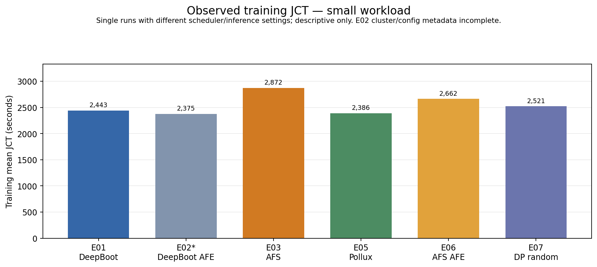
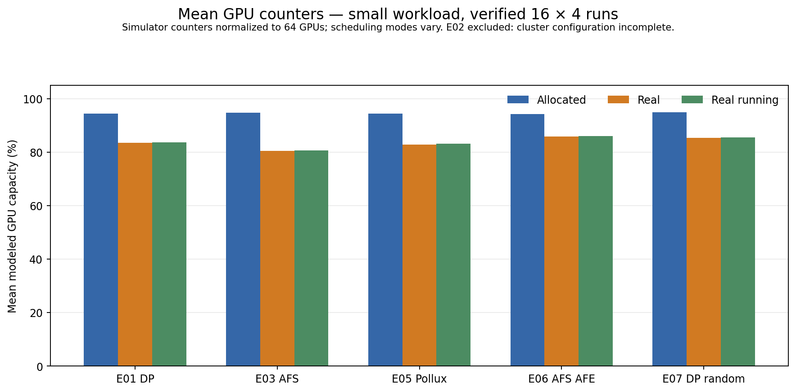
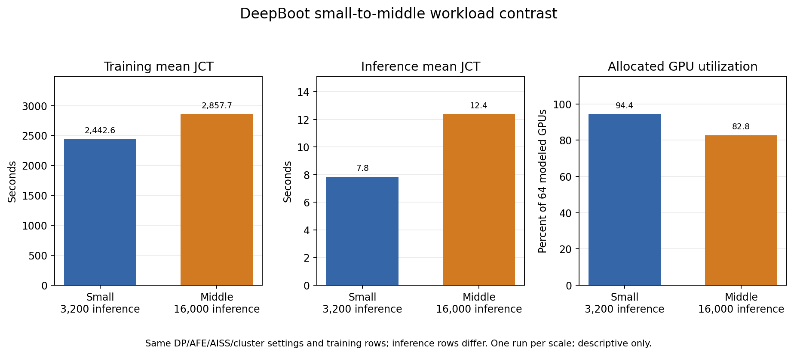

# DeepBoot Team Experiment Comparison

## 1. Project objective

The team is reproducing and analyzing the DeepBoot GPU-cluster scheduler and comparing scheduler, AFE/AISS, inference-scheduling, and workload-scale behavior using the repository simulator. This document summarizes the seven completed result sets currently present in `experiment/results/team_experiments/`. They are simulator results, not a complete numerical reproduction of the paper or physical GPU-cluster measurements.

## 2. Experiments conducted

| ID | Experiment | Status | Report / evidence |
|---|---|---|---|
| E01 | DeepBoot small baseline, AFE off | Completed | [E01 report](../experiment/results/team_experiments/E01_deepboot_baseline/experiment_report.md) |
| E02 | DeepBoot small, AFE on | Completed; invocation metadata incomplete | [E01/E02 audit](../experiment/results/team_experiments/E01_E02_audit.md); result files and partial `run_tail.log` are present, but no exact invocation record/full log. |
| E03 | AFS small baseline, AFE off | Completed | [E03 report](../experiment/results/team_experiments/E03_afs_baseline/report.md) |
| E04 | DeepBoot middle workload scaling | Completed | [E04 report](../experiment/results/team_experiments/E04_deepboot_workload_scaling/report.md) |
| E05 | Pollux small, `INFER_SCHEDULER=0` | Completed | [E05 report](../experiment/results/team_experiments/E05_Pollux-small-ATSI/experiment_report.md) |
| E06 | AFS small, AFE on, `ARYL=1` | Completed | [E06 report](../experiment/results/team_experiments/E06_AFS-small-ATSI_AFE/experiment_report.md) |
| E07 | DeepBoot small, random inference allocation | Completed | [E07 report](../experiment/results/team_experiments/E07_DeepBoot-small-ATSI_RANDOM/experiment_report.md) |

All seven runs have exit status 0 or report/metadata confirming successful completion, and their completed-job counts match the workload row counts. E02's commit and matching AFE launcher support DeepBoot `dp`, small, 16×4, AFE=1, AISS=1. Since the original invocation was not saved, these are launcher-backed intended settings rather than independently proven runtime flags; see the audit and registry confidence column. E01 wall time is a timestamp-derived estimate; E02–E07 have recorded elapsed times, with their measurement methods varying.

The inventory began on branch `main` at commit `ba6c733` with a clean working tree. The repository's `experiment/cmd/16node-4gpu/` tree contains launcher templates; `experiment/workload/` contains four CSVs; and `experiment/results/team_experiments/` contains the seven run folders. No `experiment/out/` or `experiment/results/reproduction/` output trees were present in this checkout. Framework files added by this task are not simulator or scheduler source changes.

The repository also contains launcher scripts for other configurations (including AFS without AISS, Aryl, Optimus, Tiresias, Pollux AFE, DeepBoot AFE_P8/ARYL, and pure-train Pollux). No corresponding completed output folder was found for those configurations. They are candidate configurations, not registered plans. **PENDING:** no additional experiment ID/owner/configuration is explicitly assigned in the current repository inventory.

## 3. Experiment configuration table

| ID | Scheduler / policy | Workload | Cluster | AFE | AISS | Inference scheduling mode | Configuration notes |
|---|---|---|---|---:|---:|---|---|
| E01 | DeepBoot / `dp` | small | 16 × 4 | 0 | 1 | ATS-I; `INFER_SCHEDULER=1` default, `ARYL=0` | Exact flags in E01 report; baseline setting. |
| E02 | DeepBoot / `dp` (matching launcher) | small (job names match `small.csv`) | 16 × 4 (matching launcher) | 1 | 1 | ATS-I/default allocation if launcher was used (`ARYL=0`, `INFER_SCHEDULER=1`, `random_allocate=0`) | Launcher and commit agree on principal settings; exact executed invocation remains unrecorded. |
| E03 | AFS / `afs` | small | 16 × 4 | 0 | 1 | AISS lifecycle with `ARYL=1` | `ARYL=1` selects Aryl-specific inference behavior; this is not a pure ATS-I configuration. |
| E04 | DeepBoot / `dp` | middle | 16 × 4 | 0 | 1 | ATS-I; `INFER_SCHEDULER=1` default, `ARYL=0` | Matches E01 flags/cluster; workload inference rows differ. |
| E05 | Pollux / `pollux` | small | 16 × 4 | 0 | 1 | Pollux optimizer path, `INFER_SCHEDULER=0`, `REPAIR_TRAIN=0` | Folder/script label includes ATSI, but explicit flag uses Pollux scheduling. |
| E06 | AFS / `afs` | small | 16 × 4 | 1 | 1 | AISS lifecycle with `ARYL=1` | AFE pair with E03; Aryl behavior is enabled in both. |
| E07 | DeepBoot / `dp` | small | 16 × 4 | 0 | 1 | `random_allocate=1`, `INFER_SCHEDULER=1`, `ARYL=0` | Random-allocation code path; report notes no explicit RNG/seed. |

The primary verified commands/configurations are recorded in individual reports and metadata. E02's policy and cluster dimensions come from the matching committed launcher and commit description, not from its directory name; the missing invocation record limits confidence that every launcher flag was used at runtime.

## 4. Dataset/workload descriptions

The tracked workloads are mixed training/inference CSVs with request/job rows containing `name`, `time`, `application`, `num_replicas`, `batch_size`, `duration`, and `num_task` fields. Training and inference counts below are derived from the actual workload files; inference rows are identified by `name` beginning with `inference-`.

| Workload | Rows/jobs | Training | Inference | Distinct inference application strings | Use in completed runs |
|---|---:|---:|---:|---:|---|
| `small.csv` | 3,360 | 160 | 3,200 | 6 | E01, E02, E03, E05, E06, E07 |
| `middle.csv` | 16,160 | 160 | 16,000 | 18 | E04 |
| `large.csv` | 32,160 | 160 | 32,000 | 30 | None found |
| `pure_train.csv` | 160 | 160 | 0 | No completed run found |

The table counts distinct inference `application` strings; these represent 6, 18, and 30 identifiers across 6 application families (BERT, CIFAR-10, DeepSpeech2, ImageNet, NCF, YOLOv3). The workload README describes a nominal inference-task ratio baseline of 10 and 30 inference application types, but the actual CSV row ratios are 20:1, 100:1, and 200:1 for small/middle/large. The reason for this mismatch is not documented, so comparisons use the actual CSV rows and do not reinterpret `num_task` as a job count. E01 and E04 have identical training rows, but the inference request rows are not a simple prefix/subset: only 525 inference names overlap, and those shared-name rows differ. Thus E04 is a useful workload-level contrast, not a paired inference-trace scaling experiment.

## 5. Methodology

The master CSV is regenerated by `experiment/results/team_experiments/update_tracking.py` from retained per-job results and metadata. JCT is `completion_time - submission_time`. Training jobs are separated from inference jobs by the `inference-` name prefix in `summary.json`, or by the `class` field in `job-metrics.csv`. The median and P95 use NumPy's default linear/type-7 percentile method. Overall mean JCT includes both classes and is not a training-scheduler metric.

GPU utilization values are simulator counters averaged over one-second samples and normalized to 64 modeled GPUs: `gpu_use` is allocated placement; `real_gpu_use` excludes rescaling placements; `real_running_gpu_use` includes running inference pods and training placements. These are not physical GPU telemetry. E01, E03, and E04 were recomputed from retained `gpu.log`; E05–E07 use the recorded `analysis-summary.json` because raw GPU logs are absent from their team folders. E02 has raw counters and a stored analysis normalized to 64 GPUs; the matching launcher specifies 16×4, but the absent invocation record prevents runtime verification. Its values remain in the master CSV with that provenance warning and are excluded from the verified-cluster plot.

Simulation duration is the last recorded simulation clock, not wall runtime. Failed-job counts are not emitted in these output formats, and goodput/speedup arrays are empty. Both are left blank in `master_results.csv`; blank does not mean zero. E01 runtime is an estimate based on directory/output timestamps. E02's runtime method is not specified. E03–E07 have measured/recorded elapsed values but not all use the same timing wrapper.

## 6. Results comparison tables

### Small-workload job completion times

All rows below use the small workload and the same JCT definition. The settings still differ, so this table is descriptive and does not rank schedulers.

| ID | Scheduler / relevant mode | Training mean (s) | Training median (s) | Training P95 (s) | Training max (s) | Inference mean (s) | Overall mean (s) |
|---|---|---:|---:|---:|---:|---:|---:|
| E01 | DeepBoot, AFE off, ATS-I | 2,442.58 | 984.00 | 6,751.50 | 43,773 | 7.84 | 123.78 |
| E02 | DeepBoot, AFE on; other config incomplete | 2,374.63 | 956.50 | 6,913.20 | 41,148 | 7.81 | 120.51 |
| E03 | AFS, AFE off, `ARYL=1` | 2,871.90 | 863.50 | 7,516.25 | 73,146 | 7.78 | 144.17 |
| E05 | Pollux optimizer inference path | 2,386.13 | 785.00 | 5,388.05 | 56,981 | 8.48 | 121.70 |
| E06 | AFS, AFE on, `ARYL=1` | 2,662.44 | 834.50 | 6,592.90 | 62,726 | 7.78 | 134.19 |
| E07 | DeepBoot, `random_allocate=1` | 2,520.91 | 1,070.00 | 6,784.90 | 43,068 | 7.91 | 127.58 |

E04's middle workload is shown separately in Section 9 rather than mixed into the small-workload comparison. Raw metric sources and higher precision are in [`master_results.csv`](../experiment/results/team_experiments/master_results.csv).

### GPU utilization

| ID | Workload | Allocated mean (%) | Real mean (%) | Real-running mean (%) | Cluster verification |
|---|---|---:|---:|---:|---|
| E01 | small | 94.42 | 83.46 | 83.68 | 16 × 4 confirmed |
| E02 | small | 94.69 | 90.63 | 90.87 | 64-GPU normalization; launcher specifies 16×4, runtime invocation unverified |
| E03 | small | 94.67 | 80.41 | 80.60 | 16 × 4 confirmed |
| E04 | middle | 82.77 | 72.41 | 75.34 | 16 × 4 confirmed |
| E05 | small | 94.36 | 82.88 | 83.07 | 16 × 4 confirmed |
| E06 | small | 94.26 | 85.77 | 85.98 | 16 × 4 confirmed |
| E07 | small | 94.96 | 85.26 | 85.48 | 16 × 4 confirmed |

The E02 row is a recorded value but is not used in the verified-cluster comparison plot because runtime configuration is not independently evidenced, even though the committed launcher specifies 16×4.

## 7. Scheduler comparison

The observed small-workload training means range from 2,374.63 to 2,871.90 seconds. That range is not a controlled scheduler comparison:

- E01 vs E03 changes the policy and inference behavior (`ARYL=0` vs `ARYL=1`).
- E01 vs E05 changes both scheduler and inference scheduling (`INFER_SCHEDULER=0`, `REPAIR_TRAIN=0` in Pollux).
- E01 vs E06 changes scheduler, AFE, and Aryl-specific inference behavior.
- E01 vs E07 changes the inference branch to `random_allocate=1`.
- E01 vs E02 appears intended as a DeepBoot AFE comparison; E02's launcher matches the baseline cluster and inference defaults, but the exact runtime invocation is missing.

The results can guide follow-up runs, but they do not support a general claim that one scheduler is faster than another. E05 also reports a total of 7,241.665 seconds in scheduler optimization work against 8,424.10 seconds wall time; this is a noteworthy Pollux-path observation from its recorded analysis, not a directly matched scheduler-overhead comparison.

## 8. AFE/AISS ablation analysis

### AFE

E03 and E06 form the best available AFE pair: both use AFS, `small.csv`, 16 × 4, AISS=1, and ARYL=1; they differ in AFE (0 vs 1). Training mean JCT is 2,871.90 s for E03 and 2,662.44 s for E06, a descriptive reduction of about 7.3% in this one-run pair. E06 also has lower training P95/max. These are single runs with different recorded source commits (the intervening commit changed experiment artifacts, not simulator/scheduler source), so this is preliminary evidence, not a variance-backed AFE conclusion.

E01/E02 appear to form a DeepBoot AFE pair (mean training JCT 2,442.58 vs 2,374.63 s). E02's matching launcher supports the same 16×4 workload/configuration except AFE, but the actual invocation was not captured. Treat the observed contrast as preliminary and launcher-backed, not a fully verified controlled AFE ablation.

### AISS

No completed AISS=0 result was found. Existing launcher scripts with AISS=0 are not completed experiments and provide no outcomes. Therefore the current data cannot estimate an AISS effect.

## 9. Workload scaling analysis

E01 and E04 use DeepBoot `dp`, AFE=0, AISS=1, and 16 × 4. The training rows are identical; middle has five times as many inference requests (16,000 vs 3,200) with a different inference stream.

| Metric | E01 small | E04 middle | Observed change |
|---|---:|---:|---:|
| Training mean JCT (s) | 2,442.58 | 2,857.70 | +17.0% |
| Inference mean JCT (s) | 7.84 | 12.379 | +58.0% |
| Allocated GPU utilization (%) | 94.42 | 82.77 | -11.65 percentage points |
| Real GPU utilization (%) | 83.46 | 72.41 | -11.05 percentage points |
| Simulation duration (s) | 71,460 | 77,940 | +6,480 s |

These observed values are consistent with more inference load coinciding with higher JCTs and lower average utilization in E04. Because inference rows differ in arrival times/identity and this is one run per scale, the data do not isolate request count as the cause. The workload scaling plot is explicitly descriptive.

## 10. GPU utilization analysis

Across the verified small-workload 16 × 4 runs, mean allocated utilization is narrowly clustered around 94.3–95.0%, while mean real and real-running utilization are lower. The allocated-to-real gap reflects the simulator's state counters, including placements undergoing rescaling; it is not a measured hardware-efficiency gap. E02's higher reported real utilization is excluded from the verified plot because its runtime invocation is unverified. Middle E04 has lower mean allocated and real values, but its arrival stream and horizon differ from E01.

## 11. Observed trends

- Training JCT is much larger than inference JCT across these mixed workloads, while inference requests are 95.2% of small and 99.0% of middle rows. Overall mean JCT is therefore dominated numerically by inference count and should not replace training-only mean for scheduler discussion.
- Several configurations have long training tails: maxima range from 41,148 to 73,146 seconds in the small runs. Application mix and allocation/rescale behavior matter.
- AFE-on E06 had a lower training mean than E03 in the available AFS pair, but there is only one run per setting.
- Pollux E05's explicit optimizer path has substantial recorded optimization cost; its wall-time behavior should be investigated separately from JCT.
- `metric.log` is empty across the available simulator outputs, so goodput/speedup comparisons cannot be made.

## 12. Unexpected results/anomalies

- E05's report records 7,241.665 seconds summed in scheduler optimization against 8,424.10 seconds total wall runtime, including a single very long optimization-time outlier. This suggests the Pollux configuration is unusually CPU/runtime intensive; it should be checked using retained per-decision data before drawing broader conclusions.
- E02 reports 90.63% real GPU utilization, above its allocated/real values in other runs. The committed launcher specifies 16×4 but the run invocation is missing; treat this as an artifact-reported value pending confirmation.
- E07's `random_allocate` path is named random, but its report notes no explicit RNG or seed in the inspected implementation. Do not assume statistical randomness or reproducibility from the label.
- Captured execution logs are incomplete or absent for several experiments: E01 no full log, E02 partial tail, E03 200-line tail, E04 full log local only, E05–E07 raw console logs absent from their team folders.

## 13. Limitations and threats to validity

- One run per configuration; no confidence intervals, repeated-seed variability, or significance tests.
- Most scheduler comparisons change additional inference-scheduler, AFE, AISS, ARYL, or repair settings.
- E02's exact executed command and individual report are missing; the matching launcher supplies intended, not confirmed runtime, flags.
- E03/E06 use ARYL=1 even though their names include ATSI; the actual Aryl behavior must be distinguished from ATS-I.
- E05's filename includes ATSI while its explicit `INFER_SCHEDULER=0` selects the Pollux optimizer path.
- The middle workload does not preserve the small inference trace as a prefix; workload scaling is not a one-variable trace intervention.
- Raw `summary.json`/`gpu.log`/`metric.log` availability differs across folders. E05–E07 use derived per-job CSV and analysis summaries. E02 analysis uses 64-GPU normalization, consistent with its launcher but not independently verified against runtime arguments.
- All utilization values are simulator counters on a modeled 64-GPU cluster, not telemetry from physical GPUs. Startup/rescale/interference behavior is modeled.
- Goodput/speedup and failed-job counts are unavailable; they are not zero.
- Different reports record source commits cc85a24 and 6772f55. The source diff between these commits contains experiment artifacts but no simulator/scheduler implementation changes; nevertheless exact commands/log completeness still vary.
- These data do not constitute a complete paper reproduction and should not be presented as validating paper-reported speedup factors.

## 14. Potential research directions

1. Run matched scheduler comparisons with identical workload, simulator commit, 16 × 4 cluster, AFE/AISS, ARYL, inference mode, and repair settings.
2. Complete or validate a DeepBoot AFE toggle with exact command/config metadata and repeated runs; retain E02's launcher-backed but invocation-unverified status.
3. Run an AISS=0/1 pair while holding all other variables fixed.
4. Build nested small/middle/large inference traces that preserve the smaller trace exactly, then measure workload scaling across repeated runs.
5. Resolve `ARYL=1` in the AFS scripts and label ATS-I/Aryl modes explicitly before comparing with paper setups.
6. Preserve raw per-job JCTs, raw GPU series, full console logs (or a documented compressed copy), environment, timing method, and source commit for every run.
7. If goodput or throughput is a research outcome, establish a documented supported collection method in a separately reviewed experiment; current outputs do not provide it.

## 15. Conclusions

Seven completed runs are present and can be tracked with `experiment_registry.csv` and `master_results.csv`. The current results support descriptive reporting of each run and a preliminary AFS AFE contrast plus DeepBoot small/middle contrast. They do not support a clean scheduler ranking, a general AFE/AISS effect, or a causal workload-scale conclusion. The most important follow-up is to capture exact configuration metadata consistently and run matched, repeated comparisons.

## 16. Team follow-up investigations

These investigations are tracked in [`follow_up_tracking.csv`](../experiment/results/team_experiments/follow_up_tracking.csv). Their owners and new findings were not identifiable in the repository during this audit, so they remain open with owner `UNKNOWN`. E01/E07 provide existing baseline/random artifacts, but the team's follow-up still needs to confirm whether those runs satisfy its controlled-comparison requirements. The AISS=0/1 and Pollux optimization-time investigations likewise await submitted evidence.

### Plots

