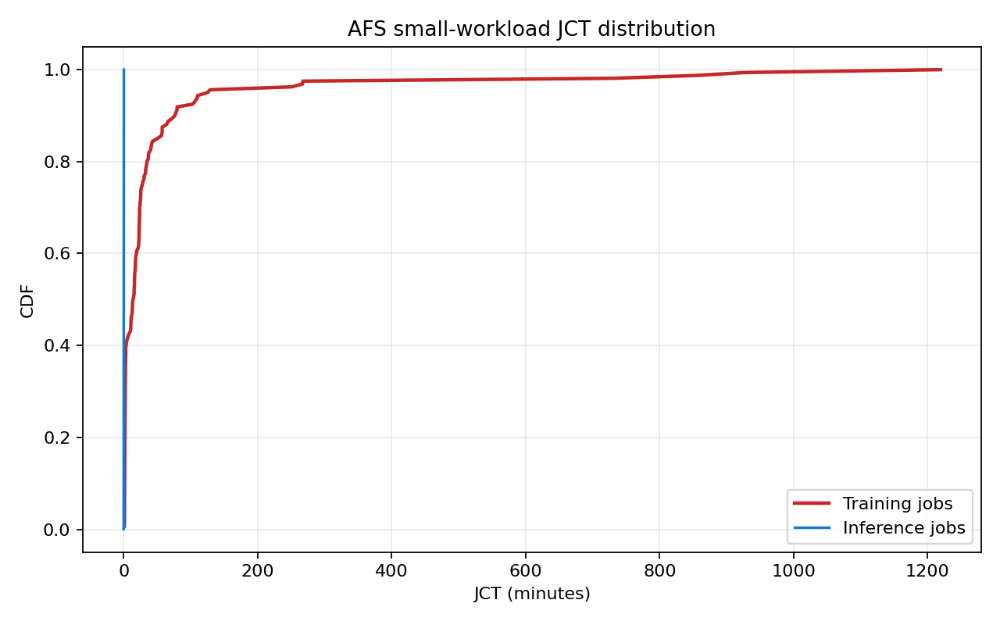
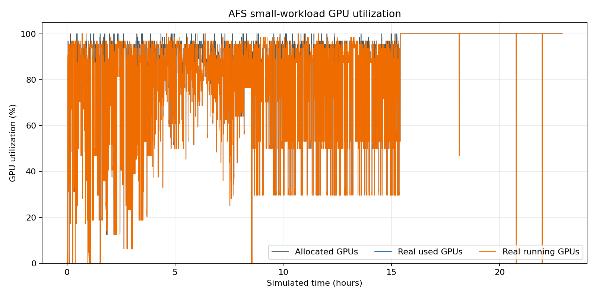
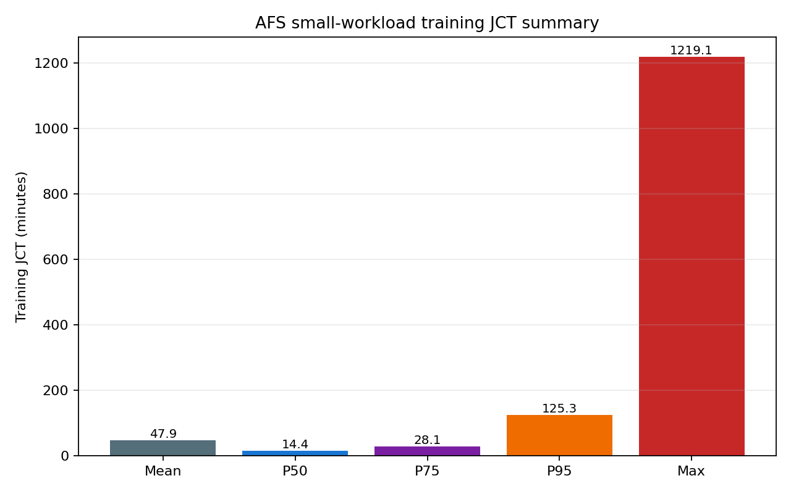

# E03: AFS Baseline (Small Workload, AISS On, AFE Off)

## 1. Objective
Run the repository's AFS scheduler (`--policy afs`) on the small mixed training/inference workload with ATS-I (AISS) enabled and AFE disabled, and record JCT and GPU-utilization results. Results are compared with the DeepBoot baseline (E01).

## 2. Configuration
| Parameter | Value |
|---|---|
| Policy | `afs` |
| AFE | 0 (off) |
| AISS | 1 (on) |
| ARYL | 1 (value used by the repository's AFS scripts) |
| Workload | `experiment/workload/small.csv` |
| Jobs completed | 3360 (160 training, 3200 inference) |
| Cluster | 16 nodes x 4 GPUs (64 GPUs) |

**Deviation from the repository scripts:** no script matches "AFS, small, AISS on, AFE off". `AFS-small.sh` has AISS=0 and `AFS-small-ATSI_AFE.sh` has AFE=1. The simulator was run directly with the command in section 4, with no source changes. This choice has not been confirmed by the team.

## 3. Environment
| Item | Value |
|---|---|
| Branch | `experiment/E03-afs-baseline` |
| Git commit | `6772f554dd104d908328f63e4ab719184c6ff4d3` |
| Python | 3.8.12 |
| Conda env | `pollux` |
| OS | WSL2 Ubuntu on Windows |
| Peak memory | 0.12 GiB |

## 4. Execution
```bash
python3 simulator.py --policy afs --workload ./experiment/workload/small.csv --AFE 0 --AISS 1 --ARYL 1 --log_file 0 --output experiment/results/team_experiments/E03_afs_baseline --min-nodes 16 --num-gpus 4
```
| Item | Value |
|---|---|
| Start | 2026-11-23T15:41:03+05:00 |
| End | 2026-11-23T15:49:50+05:00 |
| Wall-clock runtime | 8:47.80 |
| Exit status | 0 |

`execution.log` holds only the last 200 lines. The full log was 576 MB (the simulator prints every job's JCT repeatedly), so it is kept locally and not pushed.

## 5. Results
### JCT
| Metric | E03 (AFS) | E01 (DeepBoot) | Difference |
|---|---:|---:|---:|
| Training mean JCT (s) | 2871.90 | 2442.58 | +17.6% |
| Training P50 (s) | 863.50 | 984.00 | -12.2% |
| Training P75 (s) | 1686.50 | 1672.75 | +0.8% |
| Training P95 (s) | 7516.25 | 6751.50 | +11.3% |
| Training max (s) | 73146 | 43773 | +67.1% |
| Inference mean JCT (s) | 7.78 | 7.84 | -0.7% |
| Inference P95 (s) | 15.00 | 15.00 | +0.0% |
| Inference max (s) | 18.00 | 18.00 | +0.0% |
| All-jobs mean JCT (s) | 144.17 | 123.78 | +16.5% |

### GPU utilization (percent of 64 GPUs, mean over 82440 samples)
| Measure | E03 (AFS) | E01 (DeepBoot) |
|---|---:|---:|
| Allocated | 94.67% | 94.42% |
| Real used | 80.41% | 83.46% |
| Real running | 80.60% | 83.68% |

Peak allocated GPUs: 100.0%. Simulated time: 82440 s (22.90 h).





## 6. Interpretation
- Mean training JCT was 2871.9 s (47.9 min), higher than E01's 2442.6 s (+17.6%).
- Training P95 was 125.3 min and max 20.32 h, against a median of 14.4 min.
- Inference JCT: mean 7.8 s, max 18 s.
- Mean allocated utilization was 94.7% and real used 80.4%.

## 7. Limitations
- Single run on one workload; no variance estimate.
- Differs from E01 in more than the policy (ARYL=1 here vs default 0 in E01, and a different Git commit), so differences cannot be attributed to the scheduler alone.
- The AISS=1 choice was not confirmed by the team.
- The simulator is trace-driven; rescaling and restart costs are modelled, not measured.
- `metric.log` is empty, so goodput/speedup data is unavailable.

## 8. Reproducibility
1. Clone the repo and check out `6772f554dd104d908328f63e4ab719184c6ff4d3`.
2. `conda env create -f environment.yaml && conda activate pollux`
3. Run the command in section 4 with an empty output folder.
4. `python3 make_report.py` from the output folder regenerates `analysis.json`, the plots and this report.

## 9. Files
- `analysis.json`
- `execution.log`
- `gpu.log`
- `gpu_utilization.png`
- `jct_cdf.png`
- `jobinfo.log`
- `make_report.py`
- `metric.log`
- `summary.json`
- `times.txt`
- `training_jct_summary.png`
