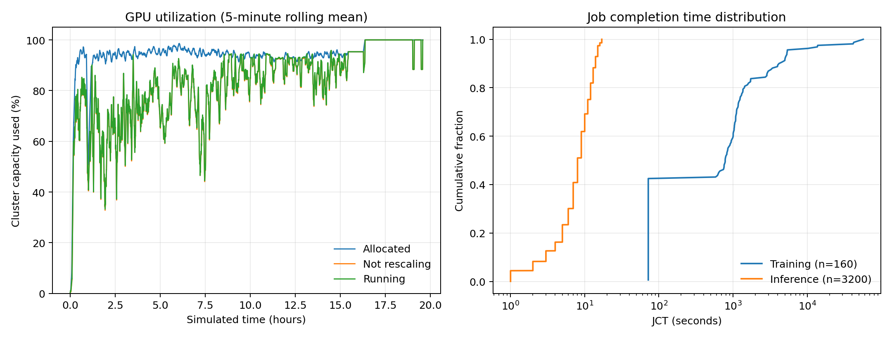

# Pollux-small-ATSI Experiment Report

## 1. Executive Summary

The repository's `Pollux-small-ATSI.sh` experiment completed successfully (exit code 0). It processed all 3,360 jobs in the small mixed workload on a modeled 16-node cluster with four GPUs per node. The run used Pollux (`policy=pollux`), AISS enabled, AFE disabled, training repair disabled, and `INFER_SCHEDULER=0`. The simulator stopped after all work completed at simulated time 70,500 seconds.

Training-only mean JCT was 2,386.13 seconds (39.77 minutes), with median 785 seconds and P95 5,388.05 seconds. Inference-request mean JCT was 8.48 seconds. Pollux's NSGA-II optimization was expensive in this configuration: 7,263 decisions averaged 0.997 seconds of wall time each, for 7,241.67 summed seconds recorded across those calls. The whole run took 8,424.10 seconds (2 hours 20 minutes 24 seconds).

## 2. Objective

Reproduce the selected Pollux script configuration, preserve the complete simulator output, and analyze training and inference completion times, allocation changes, simulated GPU counters, and scheduler overhead. The paper evaluates training-task JCT, so results are separated by job class.

## 3. Repository and Environment

- Repository: `DeepBoot`
- Branch and commit: `main`, `cc85a24b346cfac17603cdfc9f5018089ac59432`
- Python: 3.8.12, Conda environment `pollux`
- Key libraries: NumPy 1.21.4, pandas 1.3.2, SciPy 1.7.2, autograd 1.5, pymoo 0.5.0, Matplotlib 3.4.3
- Platform: Windows; simulator models 64 GPUs and does not use physical GPUs for these results.
- Source changes: none. Artifacts are stored under this report folder.

## 4. Experiment Configuration

| Setting | Value | Meaning |
|---|---:|---|
| Workload | `experiment/workload/small.csv` | 3,360 rows: 160 training jobs and 3,200 inference requests |
| Policy | `pollux` | Pollux's NSGA-II scheduling policy |
| Nodes / GPUs per node | 16 / 4 | 64 modeled GPUs total |
| `INFER_SCHEDULER` | 0 | Pollux's policy optimizer is called for scheduling events instead of the separate inference scheduler |
| `AISS` | 1 | Enables inference lifecycle/protection behavior |
| `AFE` | 0 | AFE rescaling-delay model is disabled |
| `REPAIR_TRAIN` | 0 | Training repair is disabled |
| Scheduling interval | 60 seconds (default) | Simulator scheduling interval |
| Output | `simulator-output/` | Dedicated reproduction output folder |

**Filename/configuration caveat:** Although the filename contains `ATSI`, `INFER_SCHEDULER=0` makes this script use Pollux optimization for scheduling rather than the separate ATS-I inference scheduler. The script's `exp_name` string is `Pollux-small-AISS_worepair`; it does not encode `ATSI`. I retained the actual script flag values.

## 5. Methodology

I ran the script's settings as a foreground process so its stdout and stderr could be captured. Only the output directory was redirected into this isolated reproduction folder. `summary.json` provides per-job completion time; training and inference entries were separated by their job-name prefixes. JCT is simulator completion time minus submission time.

`gpu.log` contains simulator GPU counters over time. These are modeled allocation and running counters, not device telemetry. `jobinfo.log` provides job state and the `optimize_history` data used to estimate Pollux scheduling overhead. The repository's goodput/speedup metric arrays are empty in `metric.log` because collection is disabled/commented in the simulator.

## 6. Exact Execution Command

Equivalent foreground command used to preserve output on Windows (the shell script uses `nohup` and backgrounds the process):

```powershell
$env:PYTHONDONTWRITEBYTECODE = '1'
& 'C:\Users\HP\miniconda3\envs\pollux\python.exe' -u simulator.py --policy pollux --workload experiment/workload/small.csv --AFE 0 --AISS 1 --log_file 0 --INFER_SCHEDULER 0 --output experiment/results/reproduction/Pollux-small-ATSI/simulator-output --min-nodes 16 --REPAIR_TRAIN 0 --num-gpus 4 2>&1 | Tee-Object -FilePath experiment/results/reproduction/Pollux-small-ATSI/console.log
```

The exact invocation is recorded in `command.txt`.

## 7. Execution Log and Runtime

- Start: 2026-11-22 19:35:22 +05:00
- End: 2026-11-22 21:55:46 +05:00
- Wall runtime: 8,424.10 seconds (2:20:24)
- Exit code: 0
- Completed jobs: 3,360 of 3,360
- Last recorded simulated time: 70,500 seconds; the simulator ended after all jobs completed, before the nominal 77,220-second workload horizon.
- Captured console output: `console.log` (about 1.05 GiB)

## 8. Results

### Job completion time

| Job class | Completed | Mean JCT (s) | Median JCT (s) | P95 JCT (s) | Maximum (s) |
|---|---:|---:|---:|---:|---:|
| Training | 160 | 2,386.13 | 785.00 | 5,388.05 | 56,981 |
| Inference | 3,200 | 8.48 | 8.00 | 15.00 | 17 |
| All jobs combined | 3,360 | 121.70 | 9.00 | 17.00 | 56,981 |

The combined mean is dominated by the long training tail while its median and P95 are dominated by the far more numerous inference requests. Use training-only JCT for scheduler comparisons.

### Training JCT by application

| Application | Jobs | Mean JCT (s) | Median JCT (s) | P95 JCT (s) |
|---|---:|---:|---:|---:|
| BERT | 7 | 4,144.86 | 4,166.00 | 5,366.60 |
| CIFAR-10 | 66 | 1,050.91 | 1,038.50 | 1,601.00 |
| DeepSpeech2 | 12 | 4,202.83 | 4,501.00 | 5,366.20 |
| ImageNet | 4 | 47,560.75 | 45,813.00 | 55,804.70 |
| NCF | 68 | 72.00 | 72.00 | 72.00 |
| YOLOv3 | 3 | 12,611.00 | 13,703.00 | 13,847.00 |

### Allocation changes, GPU counters, and scheduler cost

| Measure | Result |
|---|---:|
| Training allocation changes recorded as restarts | 1,602 total; mean 10.01/job; median 5/job; max 408/job |
| Training jobs with one or more allocation changes | 92 of 160 |
| ImageNet allocation changes | 626 of 1,602 (39.1%) |
| Mean allocated GPUs (`gpu_use`) | 60.39 of 64 (94.36%) |
| Mean non-rescaling GPUs (`real_gpu_use`) | 53.04 of 64 (82.88%) |
| Mean running GPUs (`real_running_gpu_use`) | 53.17 of 64 (83.07%) |
| Pollux optimization decisions | 7,263 |
| Optimization wall time per decision | mean 0.997 s; P95 1.253 s; max 2,335.784 s |
| Sum of recorded optimization wall times | 7,241.665 s (about 86.0% of total wall runtime) |
| `metric.log` | Goodput and speedup arrays empty |

The maximum optimization time is a single very large outlier (about 38.9 minutes); it should not be mistaken for typical decision time. The high mean and accumulated cost still show that Pollux scheduling consumed substantial wall time here. The GPU utilization figures are averages of the simulator's counters over its 70,500 recorded seconds.

## 9. Visualizations



The left panel shows 5-minute rolling means of modeled GPU counters. The right panel plots JCT CDFs on a logarithmic time axis so short inference requests and long training tasks are both visible.

## 10. Interpretation

Training JCT is highly skewed. Four ImageNet jobs averaged about 13.2 hours, and the three YOLOv3 training jobs averaged about 3.5 hours. In contrast, the 68 NCF jobs all completed in 72 seconds in this run. This workload/application mix means one overall average hides very different scheduler outcomes by application.

The model reports high allocated capacity (94.4%) but lower non-rescaling and running capacity (about 82.9–83.1%). Roughly 7.35 GPUs on average separate allocated capacity from the non-rescaling counter, indicating that allocation occupancy does not equal immediately running capacity in these simulator counters.

Scheduler overhead is a prominent result: the recorded optimization calls sum to 7,241.7 seconds, close to the full 8,424.1-second wall runtime. Pollux uses NSGA-II with population size 50 and 50 generations in this checkout. Since `INFER_SCHEDULER=0`, the Pollux optimizer is invoked on each scheduling event. This is consistent with the paper's concern that Pollux's NSGA-II search can impose non-negligible scheduling overhead as workload scale grows.

## 11. Comparison with the Paper and AFS Run

The paper describes Pollux's NSGA-II scheduler as incurring high scheduling overhead and notes that scheduling cost grows with workload scale. It motivates DeepBoot's ATS design partly by reducing search overhead. The paper also presents Pollux as a baseline with adaptive scheduling and elastic training. See [the paper](https://doi.org/10.1109/TPDS.2023.3293835).

In this single small-workload run, Pollux's training mean JCT is 2,386.13 seconds. The earlier AFS script run reported 2,662.44 seconds, so Pollux is about 10.4% lower on training mean JCT for these two runs. That is an exploratory comparison only: the scripts have different scheduler/inference settings (including `ARYL=1` for the AFS run and `INFER_SCHEDULER=0` here), so it is not a controlled scheduler comparison and cannot establish a general Pollux advantage.

The run's optimization cost supports the qualitative paper discussion. This run does not reproduce a paper speedup ratio or prove an ATS advantage; a matched DeepBoot ATS-I run and identical configuration would be needed for that.

## 12. Reproducibility

From the repository root, activate `pollux` and run the script's flags with a fresh output directory:

```powershell
python simulator.py --policy pollux --workload experiment/workload/small.csv --AFE 0 --AISS 1 --log_file 0 --INFER_SCHEDULER 0 --output experiment/results/reproduction/Pollux-small-ATSI/simulator-output --min-nodes 16 --REPAIR_TRAIN 0 --num-gpus 4
```

The simulator clears files inside the selected output directory at startup. Use a new directory or preserve these results before repeating it.

## 13. Limitations and Issues

- This is a discrete-event simulation, not physical GPU-cluster telemetry.
- The script name says `ATSI`, but its explicit `INFER_SCHEDULER=0` setting selects Pollux optimization instead of the separate inference scheduler.
- No matched DeepBoot run was included, so the paper's scheduler performance comparisons cannot be checked here.
- The exploratory AFS comparison has different flags and is not controlled.
- `metric.log` contains empty goodput/speedup arrays; the report cannot quantify those metrics.
- `num_restarts` represents recorded allocation changes in this implementation; it should not be read as an independent count of physical process restarts.
- Pollux's maximum optimization timing is an extreme single outlier; mean/P95 and total give more context.
- The console log is large (about 1.05 GiB) because the simulator prints verbose state at each event.

## 14. Conclusion

The Pollux script completed and produced JCT records for all 3,360 jobs. Training mean JCT was 2,386.13 seconds; inference mean JCT was 8.48 seconds. ImageNet had the longest training completion times. The modeled GPU counters show high allocation but a meaningful gap to running capacity. Pollux's NSGA-II optimizer consumed a large share of measured wall time in this configuration, aligning qualitatively with the paper's discussion of scheduling overhead. The `ATSI` filename does not match the actual `INFER_SCHEDULER=0` behavior, and the available AFS comparison is not controlled.

## 15. Next Steps

1. For a direct scheduler comparison, run the matching DeepBoot script on the same small workload and cluster configuration, preserving the intended ATS-I flag settings.
2. Confirm the intended meaning of `ATSI` in the Pollux script before changing `INFER_SCHEDULER`; rerun with a separate fresh result directory if a different configuration is intended.
3. Compare training-only average JCT, application-level distributions, and scheduler optimization overhead across matched runs.

## Artifacts

- Simulator output: `simulator-output/`
- JCT summary: `simulator-output/summary.json`
- Job state and optimization history: `simulator-output/jobinfo.log`
- Modeled GPU counters: `simulator-output/gpu.log`
- Metric arrays: `simulator-output/metric.log`
- Full console log: `console.log`
- Command and runtime metadata: `command.txt`, `run-metadata.json`
- Analysis summary: `analysis-summary.json`
- Per-job CSV: `job-metrics.csv`
- Figure: `gpu-utilization-and-jct.png`
- Analysis script: `analyze_results.py`
