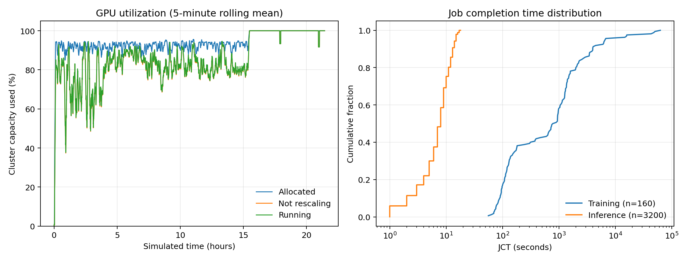

# AFS-small-ATSI_AFE Experiment Report

## 1. Executive Summary

The repository's `AFS-small-ATSI_AFE.sh` experiment completed successfully with exit code 0. It simulated the 3,360-row small workload on a 16-node, 4-GPU-per-node logical cluster using the AFS training policy, AFE enabled, AISS enabled, and the script's `ARYL=1` setting. The simulation ran for 42 minutes 49.53 seconds and reached a simulated horizon of 77,220 seconds.

The workload contains 160 training jobs and 3,200 inference requests. Training-only average JCT was 2,662.44 seconds (44.37 minutes), with a median of 834.5 seconds and a 95th percentile of 6,592.9 seconds. Four ImageNet jobs account for much of the long tail: their mean JCT was 50,984.5 seconds and they had 1,630 of the 2,359 training allocation changes counted as restarts.

This run is a reproduction of the repository script configuration, not a direct validation of the paper's AFS-versus-DeepBoot ratio. The script filename says ATS-I, but its `ARYL=1` flag selects Aryl-specific inference scheduling code in this checkout. That configuration difference matters for a paper-level comparison.

## 2. Objective

Measure the repository's AFS scheduler on the small mixed training/inference workload while retaining the script's AFE, AISS, and ARYL flags. The paper evaluates average job completion time (JCT) for training jobs; the report therefore separates training JCT from inference-request JCT.

## 3. Repository and Environment

- Repository: `DeepBoot`
- Branch: `main`
- Commit: `cc85a24b346cfac17603cdfc9f5018089ac59432`
- Python: 3.8.12 in Conda environment `pollux`
- Key packages: NumPy 1.21.4, pandas 1.3.2, SciPy 1.7.2, autograd 1.5, pymoo 0.5.0, Matplotlib 3.4.3
- Platform: Windows, 8 logical CPUs reported by Python. The simulator models a 64-GPU cluster; it does not require or measure physical GPU devices.
- Source changes: none. The run and analysis artifacts are under this report directory. `pypdf` was installed in `pollux` to extract the user-provided paper text; it is an analysis utility, not a simulator dependency.

## 4. Experiment Configuration

| Setting | Value | Meaning |
|---|---:|---|
| Workload | `experiment/workload/small.csv` | Small mixed workload; 3,360 rows, 160 training jobs, 3,200 inference requests |
| Policy | `afs` | AFS training scheduling policy |
| Nodes | 16 | Simulated worker nodes |
| GPUs per node | 4 | 64 logical GPUs total |
| `AFE` | 1 | Use the simulator's AFE rescaling-delay model on training allocation changes |
| `AISS` | 1 | Enable the inference pod lifecycle/protection behavior |
| `ARYL` | 1 | Select Aryl-specific inference scheduling behavior and the `aryl_remove` allocation post-processing in this implementation |
| `INFER_SCHEDULER` | 1 (default) | Invoke the inference scheduler between training scheduling intervals |
| Scheduling interval | 60 seconds (default) | Training policy update interval |
| `protect_time` | 30 seconds (default) | Base inference protection time; with default `protect_times=1`, protection can increase by 15-second increments up to 120 seconds |
| Interference | 0.0 (default) | No additional simulated slowdown |
| Output | `simulator-output/` | Reproduction result files; separate from the script's default `experiment/out/...` path to preserve a clean, organized run |

**Configuration discrepancy:** `AFS-small-ATSI_AFE.sh` sets `ARYL=1`. In `simulator.py` and `infer_scheduler.py`, that flag selects Aryl-specific inference scheduling behavior; it is not the ATS-I selection described for the paper's scheduler comparison. `AISS=1` enables the inference lifecycle behavior. I preserved the script's values and did not silently change the experiment to `ARYL=0`.

## 5. Methodology

The simulator reads `small.csv`, constructs the jobs and application models, and advances a discrete simulation clock. AFS chooses training allocations, while inference requests are handled using the configured inference scheduler and lifecycle state. Each training JCT is calculated by the repository as `completion_time - submission_time`.

The simulator's own printed `Average JCT` includes training and inference jobs. Because this workload contains 20 times more inference requests than training jobs, that combined average is not the right value to compare with the paper's training-task JCT. I calculated training and inference distributions separately from `summary.json`.

`gpu.log` records per-simulation-step GPU counters. In the source, `gpu_use` counts allocated placements, `real_gpu_use` excludes jobs still in rescaling, and `real_running_gpu_use` counts training allocations not rescaling plus running inference pods. These are simulator counters, not measurements of physical GPU utilization.

The repository leaves goodput/speedup metric collection commented out in `simulate()`. As a result, `metric.log` contains empty arrays; it does not provide throughput or goodput measurements for this run.

## 6. Exact Execution Command

The shell script uses `nohup`, backgrounds the process, and redirects its output to `/dev/null`. To preserve its simulator settings while capturing output on Windows, I ran the equivalent foreground command and used PowerShell `Tee-Object`. Only the output directory was redirected to the dedicated reproduction folder.

```powershell
$env:PYTHONDONTWRITEBYTECODE = '1'
& 'C:\Users\HP\miniconda3\envs\pollux\python.exe' -u simulator.py --policy afs --workload experiment/workload/small.csv --AFE 1 --AISS 1 --ARYL 1 --log_file 0 --output experiment/results/reproduction/AFS-small-ATSI_AFE/simulator-output --min-nodes 16 --num-gpus 4 2>&1 | Tee-Object -FilePath experiment/results/reproduction/AFS-small-ATSI_AFE/console.log
```

The complete command string is also in `command.txt`.

## 7. Execution Log and Runtime

- Start: 2026-11-22 17:04:31.840 +05:00
- End: 2026-11-22 17:47:21.365 +05:00
- Wall runtime: 2,569.53 seconds (42 minutes 49.53 seconds)
- Exit code: 0
- Final simulated clock: 77,220 seconds
- Warnings: NumPy emitted a `DeprecationWarning` for the legacy `np.int` alias. The simulator completed successfully; no source workaround was made.
- Captured stdout/stderr: `console.log` (about 1.15 GB; the simulator logs extensive state at each scheduling event)
- Machine-readable runtime record: `run-metadata.json`

## 8. Results

### Job completion time

| Job class | Completed | Mean JCT (s) | Median JCT (s) | P95 JCT (s) | Maximum (s) |
|---|---:|---:|---:|---:|---:|
| Training | 160 | 2,662.44 | 834.50 | 6,592.90 | 62,726 |
| Inference | 3,200 | 7.78 | 8.00 | 15.00 | 18 |
| All jobs combined (simulator's aggregate) | 3,360 | 134.19 | 8.00 | 17.00 | 62,726 |

The combined average is dominated by the much larger inference-request count and should not be used as the paper-comparable training JCT.

### Training JCT by application

| Application | Jobs | Mean JCT (s) | Median JCT (s) | P95 JCT (s) |
|---|---:|---:|---:|---:|
| BERT | 7 | 3,737.57 | 3,836.00 | 4,021.10 |
| CIFAR-10 | 66 | 1,240.14 | 1,232.50 | 2,123.00 |
| DeepSpeech2 | 12 | 4,865.50 | 5,255.00 | 6,664.10 |
| ImageNet | 4 | 50,984.50 | 49,087.00 | 60,875.30 |
| NCF | 68 | 135.84 | 111.50 | 352.60 |
| YOLOv3 | 3 | 15,472.33 | 15,754.00 | 15,910.60 |

### Restarts and GPU counters

| Measure | Result |
|---|---:|
| Training allocation changes counted as restarts | 2,359 total; mean 14.74/job; median 1/job; max 644/job |
| Training jobs with one or more allocation changes | 85 of 160 |
| ImageNet share of counted allocation changes | 1,630 of 2,359 (69.1%) |
| Mean allocated GPUs (`gpu_use`) | 60.32 of 64 (94.26%) |
| Mean GPUs not rescaling (`real_gpu_use`) | 54.89 of 64 (85.77%) |
| Mean running GPUs (`real_running_gpu_use`) | 55.03 of 64 (85.98%) |
| Scheduling decisions in `optimize_history` | 7,400 |
| Scheduler optimization wall time | mean 0.0164 s; P95 0.034 s; max 11.692 s |
| `metric.log` | Goodput/speedup arrays empty in this implementation |

The gap between allocated and non-rescaling GPU counters averages about 5.43 GPUs. The simulator's counters therefore show that high allocation occupancy did not always mean GPUs were available for useful execution, especially during rescaling.

## 9. Visualizations



The left panel shows 5-minute rolling means of the simulator's GPU counters. The right panel uses a logarithmic JCT axis so both short inference requests and long training jobs remain visible.

## 10. Interpretation

The training JCT distribution is strongly skewed. Most training jobs complete much sooner than the mean, while the four ImageNet jobs average about 14.2 hours of JCT and dominate the upper tail. Those four jobs also account for about 69% of the training allocation changes recorded as restarts. This is consistent with the paper's discussion that AFS can aggressively assign GPUs and expose large training jobs to repeated inference-driven reallocations.

Average allocated GPU occupancy was high (94.3%), but the simulator's non-rescaling/running counters averaged about 85.8–86.0%. This suggests that allocation occupancy alone overstates useful running capacity. The result does not show low average GPU occupancy for this particular script configuration; rather, it shows a sizable allocation-versus-running gap and a large restart/JCT burden for ImageNet.

The inference requests have short JCTs (mean 7.78 seconds, P95 15 seconds) in this run. Since inference makes up 95.2% of completed jobs, combining both classes masks the much larger training JCT.

## 11. Comparison with the Original Paper

The user-provided paper's Figure 9 and accompanying text (IEEE TPDS, page 2562) report that DeepBoot improves average JCT over AFS by 1.9x for the small workload, 2.1x for middle, and 1.4x for large. The paper defines average JCT as a training-task efficiency metric. See [the paper DOI](https://doi.org/10.1109/TPDS.2023.3293835).

This single AFS run cannot verify the reported 1.9x ratio because it does not include a matched DeepBoot run. In addition, the repository script's `ARYL=1` behavior differs from the paper's description of using ATS-I inference scheduling for the scheduler comparison. The comparison here is therefore qualitative and flags a configuration mismatch; it is not a claim of exact paper reproduction.

The observed long ImageNet JCT tail and high count of allocation changes align with the paper's explanation that AFS's aggressive GPU allocation can hurt large jobs under inference-driven reallocation. The measured GPU occupancy counters are nevertheless high for this run, so the paper's lower-utilization observation should not be generalized to this one configuration without a matched comparison.

## 12. Reproducibility

From the repository's `DeepBoot` directory, activate `pollux` and run:

```powershell
python simulator.py --policy afs --workload experiment/workload/small.csv --AFE 1 --AISS 1 --ARYL 1 --log_file 0 --output experiment/results/reproduction/AFS-small-ATSI_AFE/simulator-output --min-nodes 16 --num-gpus 4
```

The simulator clears files already inside the selected `--output` directory at startup. Choose a new output directory or preserve the current results before repeating the run. For live console capture in PowerShell, pipe `2>&1` through `Tee-Object` and save the console log outside the simulator output directory.

## 13. Limitations and Issues

- This is a simulator result, not a physical GPU-cluster measurement.
- `metric.log` is empty because goodput/speedup recording is commented out in the code.
- The simulator does not expose a reliable training queue-time metric in these outputs; `delay_time` records rescaling delays, not time from submission to first GPU use.
- The script sets `ARYL=1` despite the `ATSI` filename, so inference scheduling differs from the paper's described ATS-I comparison.
- There is no paired DeepBoot run here, so the paper's 1.9x small-workload ratio cannot be recalculated from this run alone.
- The full console log is about 1.15 GB due to verbose per-event state dumps.

## 14. Conclusion

The selected AFS simulation completed and produced all 3,360 job completion records. Training average JCT was 2,662.44 seconds, with the long tail dominated by ImageNet jobs and their high allocation-change counts. The run supports the paper's qualitative concern about AFS under repeated reallocations but is not an exact quantitative reproduction because the script's ARYL flag differs from the paper's ATS-I setup and there is no matched DeepBoot baseline.

## 15. Next Steps

1. Inspect and resolve the `ATSI` filename versus `ARYL=1` configuration discrepancy before making scheduler-level comparisons.
2. Run the matching `DeepBoot-small-ATSI_AFE.sh` configuration with the same workload and cluster, then compare **training-only** average JCT and per-application distributions.
3. If queue time or goodput is required, add a separately documented instrumentation change or use existing fields only where the code records them; do not infer queue time from rescaling delay.

## Artifacts

- Simulator output directory: `simulator-output/`
- Summary JCTs: `simulator-output/summary.json`
- Final job state and optimization history: `simulator-output/jobinfo.log`
- GPU counters: `simulator-output/gpu.log`
- Metric arrays: `simulator-output/metric.log`
- Captured console output: `console.log`
- Run metadata: `run-metadata.json`
- Analysis values: `analysis-summary.json`
- Per-job table: `job-metrics.csv`
- Figure: `gpu-utilization-and-jct.png`
- Analysis script: `analyze_results.py`
