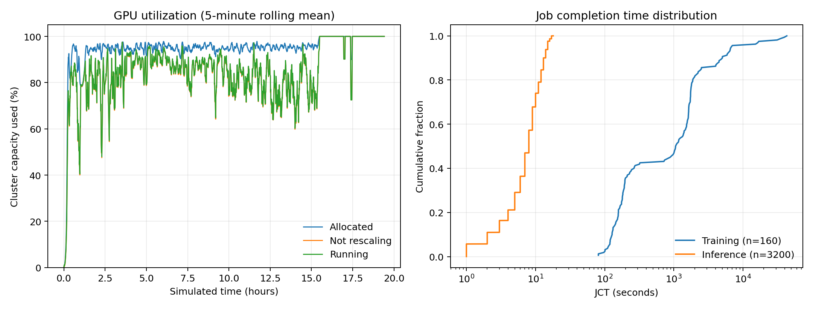

# DeepBoot-small-ATSI_RANDOM Experiment Report

## 1. Executive Summary

`DeepBoot-small-ATSI_RANDOM.sh` completed successfully with exit code 0. It processed all 3,360 jobs in the repository's small workload on a simulated 16-node cluster with four GPUs per node. The script selects the DeepBoot dynamic-programming training policy (`policy=dp`), enables AISS, disables AFE and Aryl, and sets `random_allocate=1` for the inference scheduler branch.

Training-only mean JCT was 2,520.91 seconds (42.02 minutes), with median 1,070 seconds and P95 6,784.90 seconds. The 3,200 inference requests averaged 7.91 seconds. Four ImageNet jobs had the longest training JCTs (mean 37,191.50 seconds). The run took 46 minutes 15.84 seconds of wall time, and the simulator logged 69,900 seconds of simulated time.

## 2. Objective

Reproduce the repository's DeepBoot small-workload random-inference-scheduling script, then analyze its job completion times, modeled GPU usage, allocation changes, and scheduling overhead. This helps show how the repository's DeepBoot training scheduler behaves when inference scheduling uses the script's random allocation branch.

## 3. Repository and Environment

- Repository: `DeepBoot`
- Branch and commit: `main`, `cc85a24b346cfac17603cdfc9f5018089ac59432`
- Python: 3.8.12 in Conda environment `pollux`
- Key libraries: NumPy 1.21.4, pandas 1.3.2, SciPy 1.7.2, autograd 1.5, pymoo 0.5.0, Matplotlib 3.4.3
- Platform: Windows. The simulator models 64 GPUs; the run did not use physical GPU telemetry.
- Source modifications: none. Results and analysis artifacts are saved in this report folder.

## 4. Experiment Configuration

| Setting | Value | Meaning |
|---|---:|---|
| Workload | `experiment/workload/small.csv` | 3,360 entries: 160 training jobs and 3,200 inference requests |
| `policy` | `dp` | DeepBoot's dynamic-programming training allocation policy |
| Cluster | 16 nodes × 4 GPUs | 64 modeled GPUs total |
| `AFE` | 0 | AFE rescaling behavior disabled |
| `AISS` | 1 | Inference pod lifecycle/protection behavior enabled |
| `ARYL` | 0 | Aryl scheduler behavior disabled |
| `random_allocate` | 1 | Selects `InferScheduler.random_allocate()` for non-interval inference scheduling |
| `INFER_SCHEDULER` | 1 (default) | At each 60-second interval, run the training policy; between intervals, call the inference scheduler branch |
| `REPAIR_TRAIN` | 1 (default) | The argument is not used by the `dp` policy constructor; it applies to the Pollux policy path |
| Scheduling interval | 60 seconds (default) | Interval at which the main policy is invoked |
| Interference / protect time | 0.0 / 30 seconds (defaults) | Simulator slowdown and base inference protection settings |
| Output | `simulator-output/` | Dedicated reproduction output directory |

The script filename includes `ATSI_RANDOM`, but the explicit `random_allocate=1` flag routes non-interval inference scheduling to the repository's `random_allocate()` implementation. It does not run ATS-I during those events. The `dp` policy is still used at the periodic policy intervals. In the implementation, the random branch retains existing inference allocations, assigns unallocated inference jobs from available GPUs, and updates training and sleeping-job allocations. Its code iterates a set of pending inference jobs and a list of free GPUs; no explicit random-number generator or seed is visible in that path.

## 5. Methodology

The simulator loads `small.csv`, initializes the modeled cluster and job records, and advances simulated time until all jobs complete. With `INFER_SCHEDULER=1`, it calls the `dp` policy when the clock reaches the configured interval and calls `InferScheduler.optimize()` between those times. Because `random_allocate=1`, the latter selects `InferScheduler.random_allocate()`.

JCT is computed from each job's completion time minus its submission time. I split records into training and inference classes using the job names so the training-only average can be compared to paper training-task JCT metrics. `gpu.log` contains simulator counters; these are model values, not measurements from physical GPUs. `jobinfo.log` includes allocation-change counters and the scheduler optimization history. Goodput and speedup collection is disabled in this code path, leaving `metric.log` arrays empty.

## 6. Exact Execution Command

The script backgrounds the process and discards console output. To capture it for this reproduction, I ran the equivalent foreground command with output directed into this run's folder:

```powershell
$env:PYTHONDONTWRITEBYTECODE = '1'
& 'C:\Users\HP\miniconda3\envs\pollux\python.exe' -u simulator.py --workload experiment/workload/small.csv --AFE 0 --AISS 1 --log_file 0 --ARYL 0 --output experiment/results/reproduction/DeepBoot-small-ATSI_RANDOM/simulator-output --min-nodes 16 --num-gpus 4 --random_allocate 1 --policy dp
```

The exact command is preserved in `command.txt`. `INFER_SCHEDULER=1`, the 60-second interval, interference 0, protection time 30, and `REPAIR_TRAIN=1` are defaults because the script does not override them.

## 7. Execution Log and Runtime

- Start: 2026-11-22 22:24:46 +05:00
- End: 2026-11-22 23:11:02 +05:00
- Wall runtime: 2,775.84 seconds (46 minutes 15.84 seconds)
- Exit code: 0
- Completed jobs: 3,360 of 3,360
- Last GPU log clock: 69,900 simulated seconds
- Warning: Python emitted a NumPy `DeprecationWarning` because the code uses `np.int`; the run completed successfully.
- Captured stdout/stderr: `console.log` (about 1.04 GiB)
- Machine-readable metadata: `run-metadata.json`

## 8. Results

### Job completion time

| Job class | Completed | Mean JCT (s) | Median JCT (s) | P95 JCT (s) | Maximum (s) |
|---|---:|---:|---:|---:|---:|
| Training | 160 | 2,520.91 | 1,070.00 | 6,784.90 | 43,068 |
| Inference | 3,200 | 7.91 | 8.00 | 15.00 | 18 |
| All jobs combined | 3,360 | 127.58 | 8.00 | 17.00 | 43,068 |

The combined mean and percentiles mix the two job classes and are not directly comparable to the paper's training-only mean JCT. The combined median is dominated by inference requests because they comprise most of the workload.

### Training JCT by application

| Application | Jobs | Mean JCT (s) | Median JCT (s) | P95 JCT (s) |
|---|---:|---:|---:|---:|
| BERT | 7 | 4,602.00 | 4,511.00 | 5,041.90 |
| CIFAR-10 | 66 | 1,509.89 | 1,619.50 | 2,010.75 |
| DeepSpeech2 | 12 | 5,234.33 | 6,073.00 | 6,888.10 |
| ImageNet | 4 | 37,191.50 | 37,261.00 | 42,557.10 |
| NCF | 68 | 168.29 | 161.00 | 267.60 |
| YOLOv3 | 3 | 16,152.33 | 16,305.00 | 16,884.60 |

### Allocation changes, GPU counters, and scheduling cost

| Measure | Result |
|---|---:|
| Training allocation changes recorded as restarts | 1,727 total; mean 10.79/job; median 5/job; max 335/job |
| Training jobs with one or more allocation changes | 112 of 160 |
| ImageNet share of allocation changes | 769 of 1,727 (44.5%) |
| Mean allocated GPUs (`gpu_use`) | 60.78 of 64 (94.96%) |
| Mean non-rescaling GPUs (`real_gpu_use`) | 54.57 of 64 (85.26%) |
| Mean running GPUs (`real_running_gpu_use`) | 54.71 of 64 (85.48%) |
| Scheduler decisions in `optimize_history` | 7,281 |
| Optimization wall time | mean 0.0308 s; P95 0.221 s; max 0.570 s |
| Sum of recorded optimization wall times | 224.57 seconds |
| `metric.log` | Goodput/speedup arrays empty |

The counters show high average allocated capacity, with a lower average for GPUs not rescaling or running. The difference between allocated and non-rescaling capacity is about 6.21 GPUs on average in this simulation.

## 9. Visualizations



The left panel shows 5-minute rolling means of the simulated GPU counters. The right panel plots training and inference JCT cumulative distributions on a logarithmic time axis.

## 10. Interpretation

Training JCT varies widely by application. The four ImageNet jobs averaged about 10.3 hours, while the 68 NCF jobs averaged about 2.8 minutes. ImageNet represented 44.5% of recorded training allocation changes, suggesting that long-running, large jobs account for a sizable portion of the reallocation activity in this run.

Average allocated GPU capacity was 95.0%, while the simulator's non-rescaling and running counters were around 85.3–85.5%. Thus, allocated capacity does not mean all those GPUs were immediately in useful execution according to the simulator's counters.

The recorded scheduling optimizer time was modest compared with total wall runtime: 224.57 seconds summed across 7,281 decisions. This is very different from the previous Pollux run, where NSGA-II consumed a much larger share of runtime. That observation is specific to these code paths and configurations; it is not a controlled performance comparison.

## 11. Comparison with the Original Paper

The paper's simulator evaluation uses ATS-I for inference scheduling by default in its other experiments. It also studies different inference GPU reclaiming strategies in Figure 14. The accompanying discussion says random reclaiming increasingly affects training jobs as workload scale grows because it does not account for training-task characteristics. This run is consistent with the kind of repository experiment used to examine that effect, but it only measures the small workload and cannot establish the scale trend. The paper also reports DeepBoot improvements over random and Aryl in its testbed comparison; those testbed numbers are not directly comparable to this simulator run. See [the paper](https://doi.org/10.1109/TPDS.2023.3293835).

This run's training mean JCT is 2,520.91 seconds. The earlier AFS script run measured 2,662.44 seconds and the Pollux script run measured 2,386.13 seconds. These are descriptive measurements from separate script runs, not a controlled ranking: they use different training and inference scheduling configurations. No matched ATS-I DeepBoot baseline was run here, so this experiment does not verify the paper's scheduler speedup ratios.

## 12. Reproducibility

From the repository root, activate the `pollux` environment and run the command shown in Section 6, using a fresh output path. The script's default output path is under `experiment/out/16node-4gpu/small/dp-small-AISS_RANDOM`; this reproduction instead writes to `experiment/results/reproduction/DeepBoot-small-ATSI_RANDOM/simulator-output` so that it can be retained with its log and analysis.

The simulator clears existing files inside the selected output directory at startup. Use a new directory or preserve the current files before repeating the run.

## 13. Limitations and Issues

- This is a simulator result, not physical GPU telemetry.
- The script's `ATSI_RANDOM` name does not mean the separate ATS-I scheduler is used between periodic policy updates; `random_allocate=1` selects a different inference-scheduling branch.
- The implementation's `random_allocate()` branch does not visibly call a random-number generator. It iterates pending jobs held in a set and available GPUs in order, and the command provides no random seed. Treat repeatability of the allocation order as implementation/runtime dependent.
- This result covers only the small workload; the paper's scale-dependent random-reclaiming effect cannot be established from this one scale.
- The prior AFS and Pollux measurements are not controlled comparisons because their scheduler flags differ.
- `metric.log` contains empty goodput/speedup arrays; the run cannot provide those values.
- `num_restarts` reflects the simulator's recorded allocation changes; it is not an independent measurement of physical process restarts.
- The code emits a NumPy `np.int` deprecation warning.
- The captured console log is about 1.04 GiB due to verbose per-event logging.

## 14. Conclusion

The selected DeepBoot script completed successfully and recorded all 3,360 jobs. Training mean JCT was 2,520.91 seconds and inference mean JCT was 7.91 seconds. ImageNet had the longest training JCT and the largest application-level allocation-change count. Average modeled GPU allocation was high, though running capacity was lower. The experiment provides a repository-level small-workload result for the `dp` policy with the `random_allocate` inference branch; the script's ATSI label should not be interpreted as use of ATS-I for those inference events.

## 15. Next Steps

1. Run the corresponding DeepBoot small-workload ATS-I script with random allocation disabled, retaining a separate output folder.
2. Compare training-only JCT and per-application results between random inference scheduling and ATS-I under the same workload and remaining flags.
3. Repeat at middle and large workload scales if the objective is to evaluate the paper's reported workload-scale trend.

## Artifacts

- Simulator output directory: `simulator-output/`
- JCT summary: `simulator-output/summary.json`
- Job state and scheduler history: `simulator-output/jobinfo.log`
- Modeled GPU counters: `simulator-output/gpu.log`
- Metric arrays: `simulator-output/metric.log`
- Full console log: `console.log`
- Runtime metadata and exact invocation: `run-metadata.json`, `command.txt`
- Analysis summary: `analysis-summary.json`
- Per-job metrics: `job-metrics.csv`
- Plot: `gpu-utilization-and-jct.png`
- Analysis script: `analyze_results.py`
