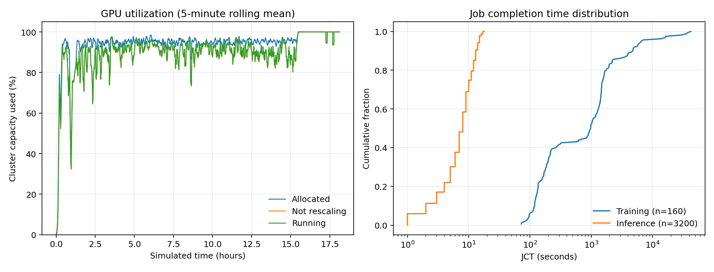

# DeepBoot-small-ATSI_AFE Experiment Report

## 1. Executive Summary

The repository script `DeepBoot-small-ATSI_AFE.sh` completed successfully with exit code 0. It processed all 3,360 workload entries on a modeled 16-node, 64-GPU cluster. With `policy=dp`, `AFE=1`, and `AISS=1`, training-only mean JCT was 2,348.025 seconds (39.13 minutes), median 976.5 seconds, and P95 6,581.5 seconds. Inference mean JCT was 7.801875 seconds.

The run took 1,805.03 seconds (30 minutes 5.03 seconds) of wall time and ended at simulated time 65,280 seconds. This is a repository experiment reproduction. It matches the paper's stated 64-GPU small-workload simulator scale and 160-training-job workload, but it does not establish the paper's exact 32% or 38% reductions because no matched baseline was run in this turn.

## 2. Objective

Measure the repository's DeepBoot dynamic-programming training policy with AFE and AISS enabled, and evaluate:

- Training and inference JCT separately.
- Per-application training JCT.
- Allocation restart/reconfiguration counts.
- Simulated GPU utilization.
- Scheduler decision cost.

This is relevant because DeepBoot combines ATS-T/DeepBoot allocation, AFE checkpoint-compatible elastic rescaling, ATS-I inference scheduling, and inference pod protection.

## 3. Repository and Environment

- Repository: `QuratUlainAhmed/DeepBoot`
- Branch: `audit/e02-configuration-forensics`
- Commit: `f1f7ada17371ccf3bbdbcc269ee074cb3f32bf2b`
- Python: 3.8.12
- Conda environment: `pollux`
- Key packages: NumPy 1.21.4, pandas 1.3.2, SciPy 1.7.2, pymoo 0.5.0, Matplotlib 3.4.3, autograd 1.5
- Platform: Windows. The simulator models 64 GPUs; no physical GPU telemetry is used.
- Source modifications: none.
- Paper: available at [the repository PDF](../../../../DeepBoot_Dynamic_Scheduling_System_for_Training_and_Inference_Deep_Learning_Tasks_in_GPU_Cluster.pdf).
- Paper text extraction: `paper.txt`

## 4. Experiment Configuration

| Parameter | Value | Explanation |
|---|---:|---|
| Script | `DeepBoot-small-ATSI_AFE.sh` | Repository's DeepBoot small-workload ATS-I/AFE script |
| Workload | `experiment/workload/small.csv` | 3,360 rows: 160 training jobs and 3,200 inference requests |
| Workload horizon | submissions through 55,375 seconds | Final workload submission time |
| Policy | `dp` | DeepBoot dynamic-programming/ATS-T training policy |
| Nodes | 16 | Cluster worker count |
| GPUs per node | 4 | 64 modeled GPUs |
| `AFE` | 1 | Enables AFE-style rescaling delay behavior |
| `AISS` | 1 | Enables ATS-I-style inference pod lifecycle and protection behavior |
| `ARYL` | 0 | Explicitly disables Aryl-specific behavior |
| `INFER_SCHEDULER` | 1 default | ATS-I inference scheduler is enabled |
| `REPAIR_TRAIN` | 1 default | Training repair setting; used in non-`dp` policy paths |
| `random_allocate` | 0 default | ATS-I, rather than random allocation, is used |
| Scheduling interval | 60 seconds default | Training scheduler interval |
| `protect_time` | 30 seconds default | Initial inference protection time |
| `protect_times` | 1.0 default | Protection multiplier; base values remain 30/15/120 seconds |
| Interference | 0.0 default | No additional simulator slowdown |
| Output | `E08_DeepBoot-small-ATSI_AFE/simulator-output` | Preserves this run separately from the script's default `experiment/out` location |

The script name and `AISS=1` indicate ATS-I lifecycle behavior. The script itself sets `AFE=1`, `AISS=1`, `policy=dp`, and leaves the default inference-scheduler and random-allocation settings unchanged.

## 5. Methodology

The foreground command loads `small.csv`, creates the 16-node/4-GPU cluster, submits jobs at workload times, advances the discrete-time simulator, and calls the DeepBoot policy for training allocations. JCT is calculated by subtracting submission time from completion time:

`JCT = completion_time - submission_time`

The simulator records each job's final completion in `summary.json`, allocation state and restart counts in `jobinfo.log`, and modeled GPU counts in `gpu.log`. Goodput/speedup collection is disabled in this code path, so `metric.log` contains empty arrays.

## 6. Exact Execution Command

```powershell
C:\Users\HP\miniconda3\envs\pollux\python.exe -u simulator.py --workload experiment/workload/small.csv --AFE 1 --AISS 1 --ARYL 0 --log_file 0 --output C:\Users\HP\DeepBoot\experiment\results\team_experiments\E08_DeepBoot-small-ATSI_AFE\simulator-output --min-nodes 16 --num-gpus 4 --policy dp
```

The exact command is also preserved in `command.txt`.

## 7. Execution Log and Runtime

- Start: `2026-11-25T19:49:18.7657000+05:00`
- End: `2026-11-25T20:19:23.7966958+05:00`
- Runtime: 1,805.03 seconds
- Exit status: 0
- Completed: 3,360 jobs
- Simulated horizon reached: 65,280 seconds
- Console log: `execution.log` (1.04+ GB due to verbose job-state and scheduling logging)
- Runtime metadata: `run-metadata.json`

The run emitted repeated NumPy `np.int` deprecation warnings in `execution.log`. These warnings do not cause failure. The final log line confirms `schedule over`.

## 8. Results

### Overall JCT

| Job class | Count | Mean (s) | Median (s) | P95 (s) | Maximum (s) |
|---|---:|---:|---:|---:|---:|
| Training | 160 | 2,348.025 | 976.5 | 6,581.500 | 42,326 |
| Inference | 3,200 | 7.801875 | 8.0 | 15.0 | 18 |
| All | 3,360 | 119.241071 | 8.0 | 17.0 | 42,326 |

The all-job mean should not be compared directly with the paper's training-task JCT. It is dominated by 3,200 short inference requests.

### Training JCT by application

| Application | Jobs | Mean JCT (s) | Median JCT (s) | P95 JCT (s) |
|---|---:|---:|---:|---:|
| BERT | 7 | 4,046.286 | 3,954 | 4,948.7 |
| CIFAR-10 | 66 | 1,326.045 | 1,395.5 | 1,939.0 |
| DeepSpeech2 | 12 | 4,855.083 | 5,279.5 | 6,785.5 |
| ImageNet | 4 | 36,114.500 | 36,441 | 41,616.8 |
| NCF | 68 | 157.956 | 136.5 | 271.5 |
| YOLOv3 | 3 | 15,460.333 | 16,124 | 16,299.5 |

### Restart and GPU results

| Measure | Result |
|---|---:|
| Total recorded training restarts | 1,798 |
| Training jobs with restarts | 92 / 160 |
| Mean restarts per training job | 11.24 |
| Median restarts per training job | 5 |
| P95 restarts | 27.15 |
| Mean rescale delay per job | 127.425 s |
| Total rescale delay | 20,388 s |
| GPU samples | 65,280 |
| Mean allocated GPUs | 60.394 / 64 (94.366%) |
| Mean non-rescaling GPUs | 57.512 / 64 (89.863%) |
| Mean running GPUs | 57.666 / 64 (90.103%) |
| Scheduling decisions | 7,204 |
| Mean scheduling wall cost | 0.027689 s |
| P95 scheduling wall cost | 0.105 s |
| Maximum scheduling wall cost | 55.305 s |
| Sum scheduling wall cost | 199.47 s |

ImageNet represented 872 of 1,798 recorded training restarts (48.5%). Its 36,114.5-second mean JCT was also the largest application mean.

## 9. Visualizations



The left panel plots 5-minute rolling means of the simulator's modeled GPU counters. The right panel plots the cumulative JCT distributions for training and inference jobs.

## 10. Interpretation

This run shows a highly skewed training workload: NCF has a short mean JCT (157.956 seconds), while ImageNet has a mean of 36,114.5 seconds. The long training tail accounts for most of the difference between the training mean and median.

The cluster averaged over 94% allocated GPU capacity, while roughly 90% of capacity was counted as not rescaling/running. This indicates that the modeled allocation was generally dense, but allocation and running counters are not identical.

Scheduler overhead was modest on average: 199.47 seconds summed across 7,204 decisions. One 55.305-second decision appears as an anomaly or expensive scheduling event, while P95 cost was 0.105 seconds.

The run ended at 65,280 simulated seconds rather than the 77,220-second nominal horizon. This is normal for this simulator: it stops once all jobs complete.

## 11. Comparison with the Original Paper

The paper is available. Its Evaluation Setup states:

- 160 training tasks.
- 16 four-GPU workers.
- 64 modeled GPUs.
- 60-second training scheduling interval.
- Small inference workload with 10 times the training-task count.
- Inference durations randomly distributed from 1–10 seconds.
- ATS-I for inference scheduling and AFE for elastic training.

The run's workload is consistent with the repository's matching small workload, and the paper is consistent with the script's key scale and flags.

The paper reports 32% JCT reduction on the testbed and 38% on the simulator against Pollux without idle inference-GPU utilization. It does not provide enough directly comparable absolute small-workload DeepBoot JCT values in the extracted text for this run to calculate a meaningful reproduction ratio.

| Comparison | Paper | E08 |
|---|---|---|
| Training workload | 160 tasks | 160 training jobs |
| Cluster | 64 simulated GPUs | 64 modeled GPUs |
| Scheduling interval | 60 s | 60 s default |
| AFE | Enabled | `AFE=1` |
| AISS | ATS-I lifecycle enabled | `AISS=1` |
| Training mean JCT | No directly comparable absolute value extracted | 2,348.025 s |
| Reported DeepBoot improvement | 32% testbed / 38% simulator | Not calculable without matching baseline |

Prior repository runs are descriptive context, not matched controls:

| Repository run | Policy | AFE/AISS | Training mean JCT |
|---|---|---|---:|
| E05 Pollux-small-ATSI | pollux | 0/1 | 2,386.13 s |
| E06 AFS-small-ATSI_AFE | afs | 1/1 | 2,662.44 s |
| E07 DeepBoot-small-ATSI_RANDOM | dp | 0/1 | 2,520.91 s |
| E08 DeepBoot-small-ATSI_AFE | dp | 1/1 | 2,348.025 s |

These runs differ in commit, branch/history, and some `ARYL/REPAIR_TRAIN/INFER_SCHEDULER` settings. They are useful as an inventory of prior measurements, not a controlled paper reproduction.

## 12. Reproducibility

From the repository root:

1. Activate Conda environment `pollux`.
2. Confirm Python 3.8.12.
3. Run the exact command in Section 6.
4. Preserve `execution.log`, `run-metadata.json`, and `simulator-output`.
5. Run `analyze_results.py`.

The simulator removes existing files in the selected output directory when it starts. E08 uses a dedicated folder so prior results are not overwritten.

## 13. Limitations and Issues

- This is a discrete-event simulation, not a physical GPU measurement.
- No matched baseline was run in this turn, so paper percentages cannot be verified.
- `metric.log` is empty because goodput/speedup collection is disabled by the implementation.
- The E08 script ran on branch `audit/e02-configuration-forensics`, while earlier reports used a different commit/branch in their metadata.
- The 55.305-second scheduling maximum is large relative to P95 and should be investigated, but it does not invalidate the exit status.
- The 1.04+ GB console log is storage-intensive and may be impractical to inspect manually.
- The paper text extraction is evidence for configuration and reported conclusions but does not expose an exact small-workload absolute JCT table.
- NumPy emits `np.int` deprecation warnings but the run otherwise succeeds.

## 14. Conclusion

The requested DeepBoot ATS-I/AFE repository experiment succeeded. It completed all 3,360 jobs and produced complete JCT, GPU, restart, and scheduling artifacts. Training mean JCT was 2,348.025 seconds and inference mean JCT was 7.801875 seconds.

The evidence supports an internal baseline result for this implementation and scale. It does **not** independently verify the paper's 32%/38% reductions, because a matched baseline and controlled repeated runs were not executed.

## 15. Next Steps

1. Run the matching Pollux baseline without idle inference-GPU utilization, under the exact paper simulator setting, and compare it with E08.
2. Repeat E08 and the baseline under fixed seeds if the implementation/random components permit deterministic scheduling.
3. Investigate the 55.305-second single scheduling decision and determine whether it is a real optimization cost or an implementation timing anomaly.
4. Run the middle workload only after the matched small-workload baseline is verified.

## Artifact Index

- [Analysis summary](analysis-summary.json)
- [Per-job metrics](job-metrics.csv)
- [Visualization](gpu-utilization-and-jct.png)
- [Execution log](execution.log)
- [Run metadata](run-metadata.json)
- [Simulator summary](simulator-output/summary.json)
- [Job information](simulator-output/jobinfo.log)
- [GPU counters](simulator-output/gpu.log)
- [Metric log](simulator-output/metric.log)
- [Analysis script](analyze_results.py)
- [Extracted paper text](paper.txt)
